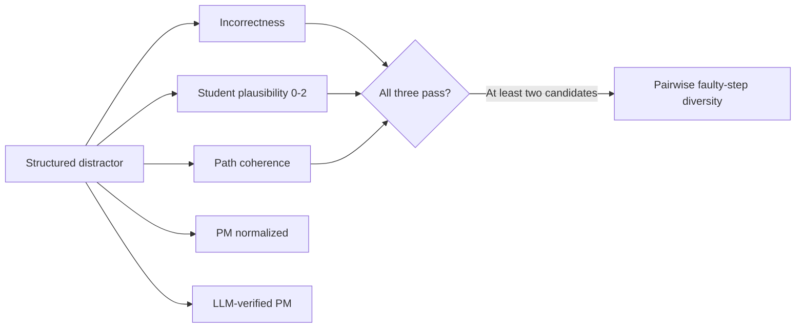
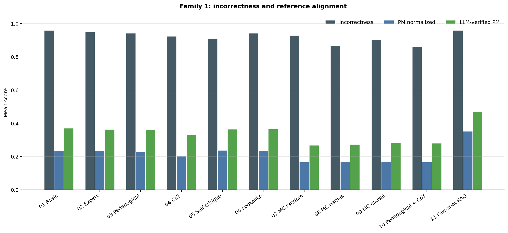
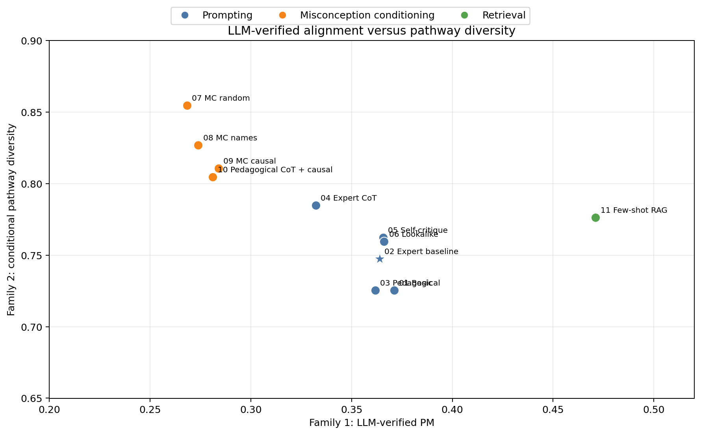
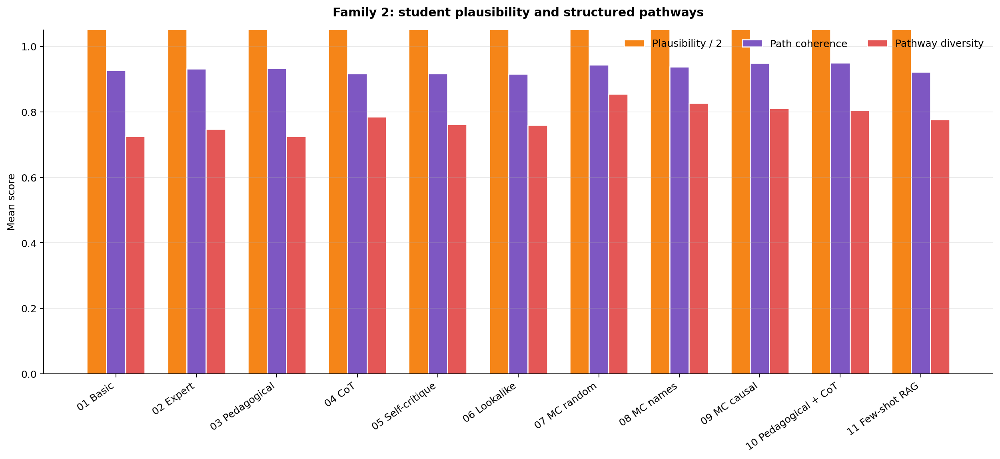

# MCQ Evaluation Overview

## Purpose

The MCQ stage supplies candidate error pathways for PF exercise generation. Evaluation therefore
keeps different claims separate:

```text
answer alignment != student plausibility != pathway coherence != pathway diversity
```

The latest saved full structured evaluation is based on 11 conditions, 200 held-out questions, and 3 runs:
6,600 question-runs and 19,800 generated distractors.

Current artifact: [structured_eval_full_v2_20260810](../../experiments/results/phase1_mcq/structured_eval_full_v2_20260810/aggregated.json).
The numbers below describe that artifact, not a new run or human validation. Roughly 62--63% of
answers per condition are `unknown` to the restricted numeric/equation incorrectness checker;
the high incorrectness rates therefore do **not** describe all 19,800 answers.

### What changed from the older evaluation (notebook 02)

| | Old (02) | Current (02b) |
|---|---|---|
| **Models** | Llama-3.3-70B + SwissAI Arctic | GPT-4.1-mini + `text-embedding-3-small-EU` |
| **Schema** | Basic generation without required paths; older artifacts use mixed field conventions | `text`, `target_misconception`, `error_rationale`; structured mode adds `faulty_step` + `reasoning_steps` |
| **Family 1** | PM · TextSim · EmbedSim | Incorrectness · PM normalized · LLM-PM |
| **Family 2** | binary validity · one-shot diversity | plausibility 0--2 (blinded to generator explanations) · optional path coherence · optional pairwise pathway diversity |
| **Scale** | 9 conditions · 5,400 runs | 11 conditions · 6,600 runs |

## Metric Map

| Family | Measure | Short explanation | Current status |
|---|---|---|---|
| Answer check | Incorrectness | Deterministic numeric/simple-equation check against the correct answer | Measured on supported formats; `unknown` is retained |
| Reference alignment | PM raw / normalized / typed | One-to-one Eedi matching using trimmed raw text, normalization, or supported typed equivalence | Measured; secondary alignment |
| Reference alignment | LLM-verified PM | GPT-4.1-mini judges mathematical answer equivalence, then performs one-to-one matching | Optional (`--llm-pm`); measured secondary experimental alignment |
| Family 2 | Student plausibility | Separate GPT-4.1-mini score from 0 to 2 for whether a student could select the distractor | Measured; plausibility proxy |
| Family 2 | Path coherence | Judge checks whether `reasoning_steps` reach the generated `text` answer | Optional (`--measure-paths`); measured for this structured artifact |
| Family 2 | Pathway diversity | Pairwise same-faulty-step judgments over incorrect, plausible, coherent candidates | Optional; measured conditionally for this artifact |
| Separate instrument | Functional diversity | Independently frozen simulated students select different options | Inactive; historical rule-level calibrations and a non-independent pilot exist, but the intended independent instrument is not validated |

Raw and typed PM remain in the saved evaluation records even when the headline result table shows
normalized and experimental LLM PM. Typed PM can equate supported numeric expressions or canonical
answer keys; it is not general symbolic equivalence. Unsupported-answer rates and measured counts
must accompany incorrectness and conditional diversity.

### Family 2 gate

Pathway diversity is not computed for every question-run. A distractor enters the pathway set only
when it passes all three component checks:

```text
incorrect + plausible + path coherent
```

If fewer than two distractors pass, diversity is `not measurable` for that question-run and the
measurement count is reported separately. It is never silently converted to zero.

The proposed functional behavioral instrument is documented in
[MCQ_FUNCTIONAL_DIVERSITY_RESEARCH_INTENT.md](functional-diversity/MCQ_FUNCTIONAL_DIVERSITY_RESEARCH_INTENT.md).

## Evaluation Flow



The historical Family 1 grouping combines answer incorrectness with secondary reference alignment;
incorrectness is not itself reference alignment. Family 2 asks whether the generated error is student-like and
whether the supplied pathway is coherent and distinct. Neither family establishes real-student PF
behavior; that requires later human or simulated-student evaluation of the resulting PF exercise.

## Family 1: Methods

### Incorrectness

For each generated answer, the deterministic checker returns one of:

- `incorrect`: a supported, parseable answer different from the correct answer;
- `correct`: equivalent to the correct answer;
- `unknown`: the answer format cannot be safely decided;
- `unusable`: empty or invalid output.

For each question-run the rate is `incorrect / (incorrect + correct)`. The condition result is the
mean of non-missing question-run rates, not a pooled distractor rate. `unknown` and `unusable`
answers are excluded, and a question-run with no decisive answers has no rate.

The checker supports numeric expressions and simple variable-equals-constant equations, plus
canonical exact equivalence. General symbolic, unit-bearing, image-dependent, and other unsupported
answers remain `unknown`; method questions can also remain unknown when expressions have the same
value but equivalent requested form is unverified. An unsupported answer is a checker limitation,
not proof of a bad distractor.

### PM normalized

PM measures reference alignment with human Eedi distractors. Generated and human answers are
matched by maximum one-to-one matching after normalization of formatting, LaTeX, symbols, whitespace,
and case. Each generated and human answer can be used at most once, so duplicate generated answers
cannot repeatedly claim the same Eedi option. The score is matches divided by generated count
(three for a complete output). It is
not a complete quality score: a novel useful distractor can have PM = 0, and a matched human option
can still be pedagogically weak.

### LLM-verified PM

For every generated-human distractor pair, GPT-4.1-mini judges whether the two texts express the
same mathematical answer in the question's context. It considers value, units, ordering, requested
form, and permitted approximation. The accepted pairs are then selected with the same one-to-one
matching rule. Unknown or failed pair judgments receive no match credit and remain auditable.

This experimental model judgment supplements, rather than replaces, deterministic PM. It is not
human-verified equivalence and does not validate student plausibility.

## Family 2: Methods

### Student Plausibility

Each generated distractor receives one separate GPT-4.1-mini judge score from `0` to `2`. The judge
sees only:

- the question text;
- the correct answer as context;
- the generated distractor text.

The judge does **not** see the generator's `error_rationale`, `faulty_step`, or `reasoning_steps`.
This prevents the generator's explanation from persuading the plausibility judgment. Path coherence
is evaluated separately.

*Improvement over the old evaluation:* the old validity judge saw the rationale, so a confident
explanation could inflate the score; this judge is blinded to it.

| Score | Definition |
|---:|---|
| `0` | Unlikely: random, irrelevant, impossible, or too obviously wrong |
| `1` | Possible but weak: related to the question but ambiguous, weakly tempting, or not strongly diagnostic |
| `2` | Likely: a recognizable, task-related error that could realistically attract a target student |

For each question-run, the three distractor scores are averaged:

$$
P_q = \frac{p_{q,1} + p_{q,2} + p_{q,3}}{3}
$$

If judgments fail, each question-run averages only its available scores; an entirely unjudged set
has no mean. In this saved run all 19,800 plausibility scores are available, so each set has three.
The condition-level mean is then the arithmetic mean of the 600 question-run means. The value is an
ordinal LLM proxy on a `0--2` scale, not a probability and not human validation. A separate screening
rate reports the fraction of distractors with `score >= 1`; it is not a replacement for the continuous
mean.

### Path Coherence

The coherence judge sees the question, the generated answer, the `faulty_step`, and the ordered
`reasoning_steps`. The LLM is asked to follow the listed steps without correcting the student's
mistake and judge whether the final result matches the generated `text` answer. This is a model
judgment, not deterministic execution or independent proof. It does not judge whether the error is
psychologically plausible; that is the role of student plausibility.

*Change from the old evaluation:* supplied paths now receive a separate model coherence judgment
rather than being assumed coherent; the old schema had no steps to inspect.

The path-coherence rate is:

$$
C_q = \frac{\text{coherent distractors}}{\text{coherent} + \text{incoherent distractors}}
$$

Unknown or failed coherence checks remain unknown and are not counted as coherent or incoherent.
The condition rate averages the available question-run rates. Missing paths are unknown, not failed;
coherence is optional for basic answer screening and needed when supplied paths support PF design
or pathway-diversity claims. The saved full run has one unknown coherence judgment (basic-direct).

### Pathway Diversity

Pathway diversity asks whether eligible distractors arise from different faulty steps, not merely
whether their answer texts differ.

```text
incorrect + plausibility score >= 1 + path coherence
```

For each eligible pair, GPT-4.1-mini compares the question, correct answer, `faulty_step`, and
`reasoning_steps`, and returns whether both distractors share the same underlying error.

*Improvement over the old evaluation:* replaces a single one-shot trichotomous set score with
auditable pairwise decisions plus a quality gate, and reports `not measurable` instead of fake zeros.

Pairwise `same_error` decisions form a graph; connected components are error classes. With `n`
eligible candidates and `k` classes, the score is `(k - 1) / (n - 1)`:

```text
3 candidates: 1 class -> 0.0; 2 classes -> 0.5; 3 classes -> 1.0
2 candidates: 1 class -> 0.0; 2 classes -> 1.0
```

If fewer than two distractors pass the gate, diversity is `not measurable`, not zero. Report the
conditional mean together with the number of measured question-runs. This is label/pathway diversity,
not the separate functional-diversity instrument based on simulated-student behavior.
The pairwise judge prioritizes faulty steps and reasoning, but also sees final answers, labels,
and rationales as supporting context. It is independent of the generation call, not independent
of the generator-supplied evidence or model family. Failed pair calls are marked `partial`; the
current aggregator includes their provisional scores, so inspect pair failures before interpreting
diversity. This saved run has 4,109 pair judgments and no failed pairs.

## Family 1: Saved Full-Run Results

The table reports the current structured run. Incorrectness is the decisive-check rate; PM values
are alignment measures, not educational-quality scores.

| Condition | Incorrectness | Measured runs / 600 | Unknown answers / 1,800 | PM normalized | LLM-verified PM |
|---|---:|---:|---:|---:|---:|
| `01_basic_direct` | 0.961 | 228 | 1,135 | 0.237 | 0.371 |
| `02_expert_direct` | 0.951 | 229 | 1,130 | 0.236 | 0.364 |
| `03_pedagogical_direct` | 0.944 | 230 | 1,126 | 0.229 | 0.362 |
| `04_expert_cot` | 0.925 | 229 | 1,134 | 0.202 | 0.332 |
| `05_expert_self_critique` | 0.911 | 233 | 1,122 | 0.238 | 0.366 |
| `06_lookalike_direct` | 0.943 | 228 | 1,135 | 0.235 | 0.366 |
| `07_expert_mc_random` | 0.929 | 238 | 1,120 | 0.167 | 0.268 |
| `08_expert_mc_names` | 0.869 | 241 | 1,131 | 0.168 | 0.274 |
| `09_expert_mc_causal` | 0.903 | 236 | 1,136 | 0.171 | 0.284 |
| `10_pedagogical_cot_mc_causal` | 0.862 | 240 | 1,126 | 0.167 | 0.281 |
| `11_fewshot_rag` | 0.961 | 233 | 1,114 | **0.353** | **0.471** |

Higher incorrectness is desirable only within the supported cases; fewer unknown answers would
provide broader coverage. Higher PM means more Eedi alignment, not necessarily better PF input.



*Figure 1. Family 1 results across conditions. Incorrectness is the decisive-check rate; PM normalized and LLM-verified PM are reference-alignment measures.*

### Family 1 Takeaway

Few-shot RAG is the clearest Family 1 result. Against the expert-direct baseline, it improves:

```text
PM normalized:   0.236 -> 0.353  (+0.117)
LLM-verified PM: 0.364 -> 0.471  (+0.107)
```

This supports the claim that retrieving similar Eedi training questions helps the generator produce
answers that align more closely with human-written distractors. It does **not** show that RAG
produces more plausible student errors, more coherent pathways, or more functionally diverse
student behavior. Those are Family 2 or downstream PF claims.

The prompting variants remain close to the baseline on Family 1. Misconception-conditioned variants
are lower on reference alignment. PM cannot credit novel unmatched errors, but these scores alone
do not establish that the unmatched errors are useful.

## Observed Trade-off

The saved structured run shows a trade-off between **reference alignment** and **error-pathway
diversity**. These are descriptive condition differences, not evidence that one metric is universally
better.

| Condition | PM normalized | Plausibility / 2 | Path coherence | Conditional pathway diversity | Diversity runs / 600 |
|---|---:|---:|---:|---:|---:|
| Expert-direct baseline | 0.236 | 1.455 | 0.932 | 0.747 | 192 |
| Few-shot RAG | **0.353** | 1.402 | 0.923 | 0.776 | 190 |
| MC random labels | 0.167 | 1.221 | 0.944 | **0.855** | 172 |
| MC retrieved names | 0.168 | 1.141 | 0.938 | 0.827 | 153 |
| MC causal | 0.171 | 1.176 | **0.949** | 0.811 | 153 |

Higher plausibility and coherence are favorable model estimates, not observed student behavior.
Higher conditional diversity means more distinct judged faulty steps among eligible candidates.
Across all 11 conditions only 151--193 of 600 question-runs per condition have measurable diversity;
the remaining sets are unavailable, not zero-diversity outcomes.



*Figure 2. Family 1 LLM-verified PM versus Family 2 conditional pathway diversity across all 11
conditions. The expert-direct baseline is marked with a star; colors identify prompting,
misconception-conditioning, and retrieval conditions.*

Relative to the expert-direct baseline, few-shot RAG adds `+0.117` PM-normalized alignment and
`+0.107` LLM-verified PM, but its plausibility is lower by `0.053` points on the 0--2 scale and its
path coherence is lower by `0.009`. RAG therefore helps the generator imitate human answer patterns;
it does not automatically make the errors more student-like.

Misconception conditioning shows the other side of the trade-off. The random-label control raises
conditional pathway diversity by `+0.107` but loses `0.068` PM-normalized points and `0.234`
plausibility points relative to baseline. Retrieved-name and causal variants show the same direction:
more pathway separation, but weaker reference alignment and lower student-plausibility scores. The
conditional diversity means are based only on question-runs with at least two valid pathways, so their
measurement counts must be read alongside the scores.

### Why This Trade-off May Occur

Distinct pathways are not inherently implausible. Direct prompting can produce familiar, recognizable
student errors, which helps plausibility, but several distractors may repeat the same underlying
mistake. Misconception conditioning forces the model to realize selected error types; some may be
weakly related to the question, subtle, or awkward to express. The resulting paths can be different
and coherent while being less tempting to a student. The high diversity of the random-label control
may therefore reflect forced separation rather than useful error routes.

This is an interpretation of the observed pattern, not a causal result. Plausibility is averaged over
generated distractors, whereas pathway diversity is measured only on question-runs with at least two
incorrect, plausible, coherent distractors. The two measures therefore do not use exactly the same
set of outputs.

### Family 2 Takeaway

No condition dominates Family 2. Basic-direct and expert-direct tie for the highest mean plausibility
(1.455 out of 2); misconception-conditioned variants have the highest coherence means
(up to 0.950), not direct prompting. Conditioning separates eligible candidate error routes more
in these model judgments, while average plausibility is lower. RAG does not by itself show
better student-like or behaviorally diverse errors.

The target for PF design is both:

```text
distinct underlying pathways + plausible student errors
```

The current results support a design trade-off in these prompts and judge-based measures, not a claim
that diversity and plausibility are fundamentally opposed. Human or independent simulated-student
evaluation is still needed to establish functional diversity.

The practical conclusion is that retrieval and misconception conditioning serve different design
goals: use question RAG when human-option alignment matters, and use misconception/pathway grounding
when discovering differentiated error routes matters. The final PF exercise still requires downstream
student or simulated-student evidence before either goal can be treated as achieved.



*Figure 3. Supporting Family 2 results. Pathway diversity is a conditional mean over question-runs that pass the incorrectness, plausibility, and coherence gate.*

## Summary of Takeaways

| | Finding | Implication |
|:---|:---|:---|
| **1. No winner** | RAG leads normalized alignment (0.353); basic/expert direct tie on plausibility (1.455 / 2); random labels lead conditional diversity (0.855). | These descriptive model/checker measures answer different questions. |
| **2. Conditional trade-off** | Random labels score diversity 0.855 on 172/600 eligible runs, compared with baseline 0.747 on 192/600; plausibility is lower (1.221 vs. 1.455). | Do not compare diversity means without their different selection counts. |
| **3. Combined condition produces more correct answers** | Its decisive-run incorrectness is 0.862, with 78 correct-equivalent outputs vs. 34 for baseline; most answers in both conditions are unknown. | This is an observed association, not proof that over-constraint causes correct answers. |
| **4. Coherence differs from incorrectness** | Causal/combined conditions have coherence 0.949--0.950 but lower supported-answer incorrectness. | A coherent path can end at a correct answer. |
| **5. Pathway diversity differs from behavioral diversity** | Conditional scores 0.725--0.855 compare generator-supplied faulty steps and paths. | Independent student attempts are still needed for a behavioral claim. |

## Scope And Limitations

- The judge is an LLM proxy, not human validation.
- Generation and current judgment both use GPT-4.1-mini routing; separate calls and blinded
  plausibility inputs do not remove shared-model bias.
- The [saved judge calibration](../../experiments/results/phase1_mcq/distractor_judge_calibration.json)
  contains synthetic development and holdout cases, not human annotations. Coherence matched
  the authored expectations on 11/12 cases; plausibility screening matched only 4/8 expected
  ranges (2/4 in each split). Higher agreement is favorable, but these small synthetic checks
  do not validate student realism. The artifact lacks a complete prompt-version record, so
  those figures cannot certify the exact prompts used for the full structured evaluation.
- Incorrectness covers only 228--241 of 600 question-runs per condition; the supported cases
  are not a random sample of all outputs. Conditional diversity further restricts this subset.
- The structured pathway judge evaluates generator-supplied paths; it does not prove that real
  students would follow them.
- Functional diversity with independent frozen simulated-student profiles has not been run;
  historical rule-level calibrations and the non-independent Test 6 pilot are not that experiment.
- Results are descriptive means; bootstrap intervals, hypothesis tests, and multiple-comparison
  correction are not included in this overview.
- Historical basic-format and old validity/diversity/PF-rubric artifacts remain available but are
  not combined with this structured evaluation.

## Offline Inspection And Future Runs

Run help from the repository root without model calls:

```bash
./.venv/bin/python scripts/evaluate_phase1_new_metrics.py --help
```

The following is a **future model-calling reevaluation**, not an offline report command. Its
source is the saved structured artifact and its output is deliberately new:

```bash
./.venv/bin/python scripts/evaluate_phase1_new_metrics.py \
  --source-dir experiments/results/phase1_mcq/structured_generation_full_v1_20260810 \
  --measure-paths --llm-pm --workers 8 \
  --output-dir experiments/results/phase1_mcq/structured_eval_next_review
```

Without `--measure-paths`, coherence and diversity are unavailable; without `--llm-pm`, only
deterministic PM tiers are computed. Default source/output paths still point to older basic-format
`full_v3_20260810` / `full_v3_new_metrics_20260810`, so pass both directories explicitly.
The evaluator overwrites its output files and uses the shared judge cache; use a distinct output
directory and retain the saved experiment when changing prompts or judge settings.

The current checker and mocked-judge behavior are specified in
[test_basic_glm_correctness.py](../../tests/test_basic_glm_correctness.py); generation schema and
retrieval contracts are specified in [test_mcq_generator.py](../../tests/test_mcq_generator.py).
Those are software checks, not student or human-annotation evidence.

## Source Files

- [Generation overview](MCQ_GENERATION_OVERVIEW.md)
- [Current evaluator](../../scripts/evaluate_phase1_new_metrics.py)
- [Structured generation runner](../../scripts/run_phase1_structured_generation.py)
- [Generator and schemas](../../src/generation/mcq_generator.py)
- [Prompt templates](../../src/generation/prompts/mcq.yaml)
- [Functional diversity research intent](functional-diversity/MCQ_FUNCTIONAL_DIVERSITY_RESEARCH_INTENT.md)