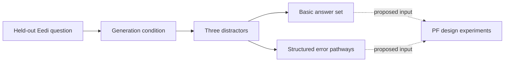
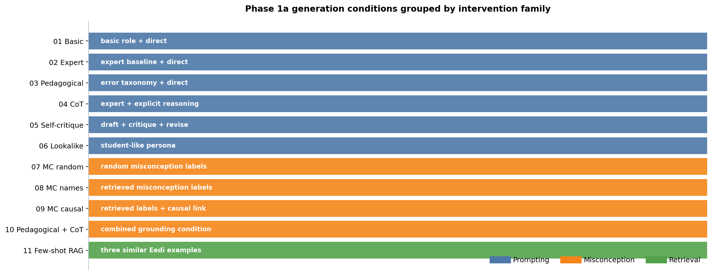

# MCQ Distractor Generation Overview

## Role In The Thesis

The MCQ stage is a design instrument for discovering plausible student error pathways that can
guide Productive Failure (PF) exercise generation. It is not the final PF contribution and it is
not evaluated only by copying Eedi answer strings.

A useful distractor is:

```text
wrong + plausible + reachable through a recognizable student error
```



## Latest Saved Structured Run

The latest saved full structured-generation experiment uses the following setup. This is
completed generation evidence, not a completed MCQ-to-PF or student-behavior experiment.

| Component | Current choice |
|---|---|
| Questions | 200 frozen held-out Eedi questions |
| Conditions | 11 generation conditions |
| Stochastic runs | 3 per question and condition |
| Total outputs | 6,600 question-runs, 19,800 distractors |
| Generator | Azure GPT-4.1-mini for every condition |
| Embeddings | Azure `text-embedding-3-small-EU` |
| Misconception bank | 2,587 Eedi misconception labels |
| Training question bank | 1,869 Eedi questions |
| Parallelism | Eight question workers; conditions run sequentially |

The [complete structured-generation artifact](../../experiments/results/phase1_mcq/structured_generation_full_v1_20260810/)
contains 6,600 unique records, each with three distractors, and no remaining generation errors.
The final files record 51 successful records requiring a second attempt within their invocation.
They do not retain a complete audit of failures removed by later retry invocations, so an exact
initial-failure count cannot be reconstructed from those files alone.

The earlier [10-question GLM pilot](../../experiments/results/phase1_mcq/basic_glm_correctness_pilot.json)
is historical basic-format evidence. Its text-only numeric/equation viability filter is available as
`--viable-only` in the structured runner; the saved full run above uses all 200 frozen questions,
not just that filtered pool. The older
[structured smoke artifact](../../experiments/results/phase1_mcq/structured_path_smoke.json) is not
the authority for the current schema. Downstream PF work is recorded separately in
[PF_PIPELINE.md](../pf-generation/PF_PIPELINE.md); a full pathway-to-PF experiment with student
approach evidence has not been established.

## Generation Conditions

`02_expert_direct` is the baseline: an expert role, direct instruction, and no retrieved context.
The other conditions change one source of guidance or add a deliberate combination.

| Condition | Family | Intervention | Research purpose |
|---|---|---|---|
| `01_basic_direct` | Prompting | Minimal role + direct instruction | Lower-bound prompt |
| `02_expert_direct` | Prompting | Expert role + direct instruction | Standard baseline |
| `03_pedagogical_direct` | Prompting | Error taxonomy + diagnostic framing | Pedagogical framing |
| `04_expert_cot` | Prompting | Enumerate errors before selecting answers | Explicit reasoning |
| `05_expert_self_critique` | Prompting | Draft, critique, and revise | Self-review |
| `06_lookalike_direct` | Prompting | Simulate authentic student mistakes | Student-like framing |
| `07_expert_mc_random` | Misconception conditioning | Five random Eedi misconception labels | Random-label control |
| `08_expert_mc_names` | Misconception conditioning | Five semantically retrieved labels | Label grounding |
| `09_expert_mc_causal` | Misconception conditioning | Retrieved labels plus causal answer linking | Error-to-answer grounding |
| `10_pedagogical_cot_mc_causal` | Misconception conditioning | Pedagogical role + CoT + causal grounding | Combined condition |
| `11_fewshot_rag` | Retrieval | Three similar Eedi training examples | Feng-style kNN/RAG analogue |



*Figure 1. The 11 generation conditions grouped into prompting, misconception-conditioning, and retrieval interventions.*

### Misconception Conditioning

Conditions 8--10 retrieve five misconception labels using a query containing:

- the question stem;
- `SubjectName`;
- `ConstructName`.

The held-out question's misconception IDs are never sent to the generator. They are used only after
generation to audit whether the retrieved candidate set contains a reference misconception. The
random control samples five labels from the full bank and records the same audit separately.

The Eedi mapping contains names, not full human-authored descriptions. Therefore condition 9 is a
causal-linking prompt, not a claim that the model received a complete taxonomy.

### Few-Shot Retrieval

Condition 11 retrieves three semantically similar Eedi training questions and supplies their correct
and wrong answer examples. The target question is excluded by `QuestionId`, so duplicate question
stems in the training bank remain eligible when they are different records.

The question index and misconception index use provider-specific Azure cache keys. Embedding calls
are batched at 2,048 inputs because the Azure endpoint rejects larger input arrays.

## Output Contract

Every basic distractor contains:

```json
{
  "text": "bare wrong answer",
  "target_misconception": "specific error label",
  "error_rationale": "why a student might select it"
}
```

Structured mode additionally requires a proposed student-error pathway. The following is an
illustrative schema example, not a measured student response:

```json
{
  "text": "120",
  "target_misconception": "Forgets the weeks-to-days conversion",
  "error_rationale": "The student converts days to hours but omits the weeks conversion.",
  "faulty_step": "Skips the weeks-to-days conversion",
  "reasoning_steps": [
    "Convert 5 weeks to 5 days instead of 35 days",
    "Multiply 5 x 24",
    "Produce 120"
  ]
}
```

The structured runner requires non-blank `faulty_step`, at least one non-blank `reasoning_steps`
entry, and exactly three distractors. The base Pydantic schema requires pathway fields but does not
itself enforce the three-item count or reject whitespace-only strings; the runner supplies those
additional checks. These are format checks, not proof that the proposed path reaches the answer.

The runner makes up to two attempts per record and retains a failed record with `generation_error`
if both fail. `--resume` skips existing question/run keys; `--resume --retry-failures` removes failed
rows from that condition file and regenerates their keys. Back up a failure artifact before using
that option if the complete failure history is needed. An empty failed output is not a success.

`predicted_answer` and `student_calculation` are not part of the current schema. The structured
path fields above are the fields used by the current path-coherence and pathway-diversity judges.

## Generation Flow

1. Load the frozen question and correct answer.
2. Select the condition's system role, instruction, and optional context.
3. Generate exactly three distractors as structured JSON.
4. For structured mode, require the faulty step and ordered reasoning steps in the same response.
5. Save the condition, question ID, run, generated fields, conditioning provenance, and timing.
6. Evaluate the saved artifact separately using the current metric runner.

The generation runner is [scripts/run_phase1_structured_generation.py](../../scripts/run_phase1_structured_generation.py).
The condition definitions and client construction are in [scripts/run_phase1_mcq.py](../../scripts/run_phase1_mcq.py).
The generator and schemas are in [src/generation/mcq_generator.py](../../src/generation/mcq_generator.py).
The prompt templates are in [src/generation/prompts/mcq.yaml](../../src/generation/prompts/mcq.yaml).

## Commands And Configuration

Run from the repository root with Python >=3.10 (`./.venv/bin/python` when available). These help
commands are offline; generation commands below make model/embedding calls and were not rerun
for this documentation audit.

```bash
./.venv/bin/python scripts/run_phase1_structured_generation.py --help
./.venv/bin/python scripts/evaluate_phase1_new_metrics.py --help

# Future small calibration; use a fresh output directory.
./.venv/bin/python scripts/run_phase1_structured_generation.py \
  --condition 02_expert_direct --viable-only --n 3 --runs 1 --workers 2 \
  --results-dir experiments/results/phase1_mcq/structured_generation_next_calibration
```

Azure clients load local environment configuration through
[run_azure_mcq_plausibility.py](../../scripts/run_azure_mcq_plausibility.py) and
[config.py](../../src/utils/config.py). The few-shot branch selects `models["gpt41mini"]`;
other branches use `LLMClient.from_role("structured")`. Deployment environment overrides can
change the actual model, so GPT-4.1-mini describes the saved run and default routing, not an
immutable guarantee for future runs. The runner's default output is
`structured_generation_v1_20260810`, **not** the full saved directory cited above; always pass an
explicit fresh `--results-dir` to avoid appending duplicate records or mixing experiments.

## Evidence Boundary

Generation produces candidate pathways; it does not establish that real students would produce
them. Incorrectness, plausibility, path coherence, and label-based pathway diversity are evaluated
separately in [MCQ_EVALUATION_OVERVIEW.md](MCQ_EVALUATION_OVERVIEW.md). The proposed behavioral
functional-diversity instrument remains separate and is documented in
[MCQ_FUNCTIONAL_DIVERSITY_RESEARCH_INTENT.md](functional-diversity/MCQ_FUNCTIONAL_DIVERSITY_RESEARCH_INTENT.md).