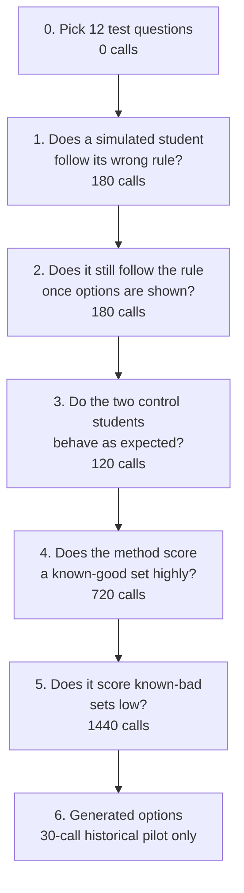

# Functional Diversity: A Worked Walkthrough

> Status: inactive in the current MCQ evaluator. Historical rule-level Tests 1--5 and a
> 30-call, non-independent Test 6 demonstration have been saved. The intended independent,
> belief-only student instrument and the proposed column-distance analysis are not implemented
> as a validated end-to-end measurement. This walkthrough separates those proposals from the
> completed calibration evidence. See
> [research intent](MCQ_FUNCTIONAL_DIVERSITY_RESEARCH_INTENT.md) for the current decisions.

## The idea in one sentence

A set of distractors is diverse if **different kinds of struggling students pick different distractors**. If every struggling student ends up picking the same option, the set only looks diverse on paper.

This replaces asking *"do these distractors have different labels?"* with *"do these distractors catch different students?"*.

## Why not just compare the generator's own labels

The existing [pathway-diversity check](../MCQ_EVALUATION_OVERVIEW.md) compares `faulty_step` and
`reasoning_steps` first, with final answers, labels and rationales as supporting context. It explicitly
warns against treating different wording as different errors. It still evaluates generator-supplied
paths, not the approaches independent students actually produce.

The proposed functional instrument would use independent profile behavior rather than generator
labels. The historical procedure-based calibration is not yet that independent instrument.

## The whole process, step by step

### Step 0: Pick a worked example

Question:

> A student council has EUR240 to divide between two clubs whose membership ratio is 1:3.

Correct answer: EUR60 / EUR180 (four parts, EUR60 each).

Three illustrative distractors (not saved model outputs):

| ID | Text | Generator's claimed error |
|---|---|---|
| `d1` | EUR120 / EUR120 | "Splits equally instead of by ratio" |
| `d2` | EUR80 / EUR160 | "Treats the ratio like a fraction of the total" |
| `d3` | EUR180 / EUR60 | "Reverses which club gets which share" |

The numbers below are illustrative, chosen to make the process easy to follow. They are not from a real run.

### Step 1: Build a student missing one knowledge component (KC, a skill)

A one-missing-skill profile is a simulated student who lacks **exactly one** prerequisite skill and
has the others. Specify a belief or missing concept, not an answer-producing procedure. Build these
from an independent skill bank (for example
[data/eedi_scraped/_skill_bank.json](../../../data/eedi_scraped/_skill_bank.json)), never from the
distractor's own claimed error. The existing `StudentProfile.to_prompt_block()` injects explicit
error rules and would need adaptation for this proposed belief-only experiment.

| Profile | Missing KC | Everything else |
|---|---|---|
| `p1` | Ratio is part-to-part, not an equal split | mastered |
| `p2` | A ratio is not the same as a fraction of the total | mastered |
| `p3` | Order in a ratio corresponds to a specific group | mastered |

Add two controls:

- `p_expert`: nothing missing. Must pick the correct answer, or the simulator itself is broken.
- `p_floor`: everything missing. A sanity check for "attracts everyone" distractors.

For the final experiment, use more profiles than distractors, typically 6-9 profiles for 3 distractors. Do not force one-to-one profile ownership. Build the pool independently, freeze it before seeing the generated distractors, and report distractors selected by no profile as `uncovered` rather than silently treating them as low diversity.

### Step 2: Run every profile against the question, repeatedly

The proposed design repeats each profile about 20 times and records a reasoning trace, intermediate
answer and option choice, including `OTHER` when the answer is absent. Run controls separately.
Twenty repeats is a design starting point, not a validated sufficient sample size.

### Step 3: Build the table

This table is the entire result. Everything else is just reading it.

| | picked `d1` | picked `d2` | picked `d3` | picked correct |
|---|---:|---:|---:|---:|
| `p1` (no ratio-vs-equal) | **14** | 3 | 1 | 2 |
| `p2` (no ratio-vs-fraction) | 2 | **15** | 1 | 2 |
| `p3` (no ratio order) | 1 | 2 | **15** | 2 |

A strong diagonal, like above, means each distractor catches the student it was meant for.

### Step 4: Decide "same" vs "different" from the columns, not the labels

Take each column (one distractor) and turn it into a distribution over profiles by dividing by its column sum:

```text
d1 -> (14/17, 2/17, 1/17) = (0.82, 0.12, 0.06)
d2 -> (3/20, 15/20, 2/20) = (0.15, 0.75, 0.10)
d3 -> (1/17, 1/17, 15/17) = (0.06, 0.06, 0.88)
```

Proposed comparison: Jensen-Shannon distance, the square root of the symmetric divergence between
two distributions. With base-2 logarithms it is bounded from 0 (identical) to 1 (disjoint). Specify the
logarithm base and distinguish distance from divergence when implementing it.

The illustrative columns recruit different profiles, but "same" versus "different" needs a
sampling-noise comparison, not an invented universal cutoff.

### Step 5: Set the "same vs different" threshold from noise, not by guessing

Proposed analysis: split each profile's repeated attempts into two halves, build the same distractor's
profile distribution in each half, and compare them. Repeat across splits and covered distractors.
This estimates sampling noise; low or empty column counts need explicit unavailable states.

A 95th-percentile noise threshold is a proposal requiring calibration and a separate holdout check.
No typical numerical threshold is established in the saved artifacts, and exceeding it would be
evidence of simulated response separation, not proof of a real-student difference.

### Step 6: Lead with coverage counts; use association scores secondarily

Report how many distractors were selected by at least one profile, how many remain uncovered, and
how many documented error responses are missing from the offered options. An uncovered option has
no behavior evidence; it is not automatically non-functioning for real students.

Any normalized mutual information (NMI, association between profile and option) is secondary.
The proposed independent analysis should use generated-distractor columns only, exclude correct/
`OTHER`/unparseable choices, and report its retained sample size. A permutation null shuffles
profile labels to estimate association from chance; this restriction is not implemented in the
archived Test 6 scorer. High NMI alone can coexist with zero generated-option coverage.

In this synthetic example, **modal coverage** (options that are a profile's unique most-picked
choice) is `3/3`: all three illustrative distractors have such a profile. This is a teaching example,
not a measured result or a requirement for one-to-one profile ownership.

## Verification Plan: Does the Functional Diversity Method Actually Work?

The table below preserves the original rule-level calibration plan and its thresholds. Tests 1--5
have saved preliminary results; Test 6 has only a 30-call, non-independent demonstration. The final
belief-only independent experiment has not run. These tests check instruction adherence and scoring,
not whether simulated students faithfully represent real learners.



| # | Test | What it checks | Size | Go if | Stop if |
|---|---|---|---|---|---|
| 0 | Pick 12 starter questions | Questions with a known, well-labelled correct answer and enough sibling questions (other questions on the same skill) to build a fair profile pool | 0 calls | 12 qualifying questions found | fewer than 12 exist |
| 1 | Rule-following, no options shown | Give the model only the student description (its missing skill + wrong rule) and the bare question; check if the free-form answer matches what the rule predicts | 12 q x 3 rules x 5 repeats = 180 | rule followed >= 70% | < 50% |
| 2 | Rule-following, options shown | Same as Test 1 but now the 4 multiple-choice options are visible, as in the real run; a model that "knows better" may abandon the rule once it sees the correct answer listed | 12 x 3 x 5 = 180 | drop from Test 1 < 15 points | drop >= 15 points |
| 3 | Control students | Two safety-check students: an **expert** (no missing skill, must pick the correct answer) and a **blank slate** (knows nothing, used later to flag options everyone picks) | 12 x 2 x 5 = 120 | expert correct >= 90% | < 90% |
| 4 | Known-good set | Run the full method on Eedi's own human-written distractors, where we already know which wrong rule maps to which option; the result should show each student clearly preferring a different option | 12 x 3 profiles x 20 repeats = 720 | alignment score >= 0.6 (0 = students indistinguishable, 1 = each student's choice is fully predictable) | < 0.6 |
| 5 | Known-bad sets | Run the method on sets built to be non-diverse (three options that are really the same mistake) and on sets with no reasoning at all; the score must drop | 12 x 2 bad sets x 3 x 20 = 1440 | scores >= 0.3 below Test 4 | scores similar to Test 4 |
| 6 | Generated distractors | Original plan: apply the calibrated setup to generated options. Current evidence: two-question, 30-call non-independent pilot only | Final scope not run | No validated independent result | Fix readout and profile independence before reactivation |

### Why these questions are the starting point

The 15 questions selected for Test 0 are the easiest possible case for this method. They have short questions, one clear correct procedure, three mechanical mistakes, and three different predictable wrong answers. If the simulated-student machinery cannot work here, it cannot work anywhere. That is exactly why these questions are the right starting point.

This is a test of the measurement machinery, not yet a test of Productive Failure. The questions are intentionally simple so that a failed result has a clear meaning: either the simulated student did not follow its assigned wrong rule, or the method did not distinguish the resulting choices. Passing this test does not show that the method can measure different approaches in an open-ended exercise. It only shows that the basic instrument works in a controlled case.

**Original budget rationale:** Tests 1--3 require 480 calls per model and Tests 4--5 require 2,160
per model under this plan; revisions and two-model runs add calls. The planned final generated-option
experiment was to be interpreted against known-good and negative controls, not as a stand-alone score.

**Rule:** the go/stop numbers in the table above must be written down before running each test. Choosing a threshold after seeing the result would not count as a real check.

## First calibration: can GPT-4.1 follow a wrong rule?

Before using profiles to measure distractor diversity, we tested whether GPT-4.1 can follow a fixed wrong rule when the answer choices are hidden. A **profile** here means one simulated student with one assigned mistake.

We used 12 simple questions, 36 profiles, and five repeats per profile. This produced 180 calls, sent with 10 workers in parallel.

| Check | Result | Meaning |
|---|---:|---|
| API calls completed | 180/180 = 100% | Every request returned a response |
| Answers had the requested JSON format | 180/180 = 100% | Every response could be read |
| Wrong rule was followed | 170/180 = 94.4% | GPT-4.1 usually made the assigned mistake |
| Continue boundary | 70% | 94.4% is above the pre-set boundary |

**Simple example:** For $12^2$, one profile was told: “When asked to square a number, multiply it by 2 instead.” The expected answer was $24$. GPT-4.1 followed this rule in all five repeats. It did not answer the mathematically correct $144$.

The 10 failures were concentrated in three profiles. Applying a negative sign only to the second bracket term worked in 2/5 repeats for each of two questions. Multiplying only the second bracket term worked in 1/5 repeats. The other 33 profiles followed their assigned rule in all five repeats.

Some responses included short working, such as `1 x 2 = 2`, instead of only the final answer `2`. These counted as correct because the final result still followed the assigned rule. This keeps answer formatting separate from rule-following.

**What this tells us:** GPT-4.1 can usually be controlled as a simulated student for these simple questions, so the next test is reasonable. It does not show that GPT-4.1 behaves like a real student, and it does not yet show that the functional-diversity score is valid.

The [Test 1 profile specification](../../../experiments/configs/functional_diversity_test1_profiles.json), [runner](../../../scripts/run_test1_rule_following.py), and [saved result](../../../experiments/results/functional_diversity_test1_rule_following_gpt41.json) record the calibration setup and output.

## Test 2 result: do visible options override the wrong rule?

**Status:** preliminary calibration complete, but the pre-set continue boundary was not met.

We repeated the same 180 calls from Test 1, using the same 12 questions, 36 profiles, five repeats per profile, and 10 parallel workers. The difference was that GPT-4.1 could now see all four answer options and had to choose one option.

| Check | Result | Meaning |
|---|---:|---|
| API calls completed | 180/180 = 100% | The endpoint worked for every request |
| Choices had the requested JSON format | 180/180 = 100% | Every selected option could be read |
| Wrong rule was followed | 123/180 = 68.3% | The model often abandoned the assigned mistake |
| Drop from Test 1 | 26.1 percentage points | This is larger than the 15-point limit |
| Pre-set decision | Stop and revise | The original prompt did not meet the prescribed-option recovery gate |

**Simple example:** For $12^2$, the profile says “multiply by 2 instead of square,” so the expected choice is $24$. With the options visible, GPT-4.1 still selected the intended wrong option reliably in this case. This shows that some profiles survive the transition from free response to multiple choice.

**Failure example:** For the range question with values $5, 19, 6, 2$, one profile says “take the absolute difference between the first and last values,” which gives $3$. The intended choice is C. When all options were visible, GPT-4.1 selected A, the correct answer $17$, in all five repeats. The output was valid, but the simulated student did not preserve its assigned mistake.

The failure is behavioural, not technical: all 180 requests returned valid choices. The model followed the wrong rule in free response, but often returned to the correct answer or selected another option once the choices were shown.

**Historical decision:** the original Test 2 failed its pre-set boundary and prompted revision.
The revised results below supersede that stop decision for this rule-level calibration, not for the
proposed belief-only instrument. Test 1 alone was not sufficient validation.

The [Test 2 runner](../../../scripts/run_test2_rule_following_with_options.py) and [saved result](../../../experiments/results/functional_diversity_test2_option_following_gpt41.json) record this run.

### Prompt-design lesson: make the wrong answer explicit first

The main improvement in the revised prompt was not simply stronger wording. It required the model to follow a visible sequence:

```text
1. Apply the wrong procedure.
2. Calculate the answer produced by that procedure.
3. Compare that answer with the options.
4. Select the matching option.
```

The original prompt asked only for an option letter. That allowed GPT-4.1 to solve the question normally and then choose an option. The revised prompt also requested the **intermediate simulated answer**, meaning the wrong answer calculated before selecting an option:

```json
{
	"simulated_answer": "3 cm",
	"selected_option": "C"
}
```

This requests an intermediate answer before the option pick, though both are generated in one call
with options visible; it is not a true hidden-options commitment. In the full 12-question run,
GPT-4.1 followed the answer rule in 149/180 calls (82.8%) but selected the intended option in
146/180 (81.1%). GPT-4.1-mini selected the intended option in 170/180 calls (94.4%). Higher recovery
means better adherence to the prescribed rule, not greater realism as a student.

### Full revised Test 2 check

The revised prompt was then run on all 12 questions, with 180 calls per model. GPT-4.1 recovered the expected option in 146/180 calls (81.1%), a 13.3-point drop from its 94.4% Test 1 baseline, so it remained below the 15-point stop boundary. GPT-4.1-mini recovered 170/180 options (94.4%). Its strict matched no-options baseline has not yet been run on all 12 questions; the available 100% baseline came from the smaller 3-question calibration.

Results: [GPT-4.1](../../../experiments/results/functional_diversity_revised_test2_full_gpt41.json) and [GPT-4.1-mini](../../../experiments/results/functional_diversity_revised_test2_full_gpt41mini.json).

### Small ablation: do worked examples improve it further?

We compared the revised prompt with and without three short examples covering percentage, fraction division, and bracket expansion. Both versions used the same 9 profiles and 5 repeats per profile: 45 calls per version, with 10 workers.

| Prompt version | Wrong rule followed | Intended option selected |
|---|---:|---:|
| Revised prompt without examples | 40/45 = 88.9% | 40/45 = 88.9% |
| Revised prompt with three examples | 40/45 = 88.9% | 40/45 = 88.9% |

The GPT-4.1 point estimates showed **no observed improvement**. The earlier procedural revision
improved intended-option recovery, but this small three-question comparison does not establish that
worked examples never help or isolate why the earlier revision helped.

The [paired ablation runner](../../../scripts/run_prompt_ablation_test2.py) and [saved comparison](../../../experiments/results/functional_diversity_test2_prompt_ablation.json) record the two prompt variants and their outputs.

GPT-4.1-mini followed the rule in 45/45 baseline calls (100%) and 40/45 example calls (88.9%), so examples reduced adherence by 11.1 percentage points in this small comparison ([result](../../../experiments/results/functional_diversity_test2_prompt_ablation_gpt41mini.json)).

## Test 3 result: do the control students behave?

We tested an **expert control** (should always choose the correct answer) and a **floor control** (should make an uninformed choice) on 12 questions, with 5 repeats per control and model. Both models were run concurrently: 240 calls total.

| Model | Expert correct | Floor choices | Largest floor preference |
|---|---:|---|---:|
| GPT-4.1 | 60/60 = 100% | A: 1, B: 24, C: 22, D: 13 | 40% for B |
| GPT-4.1-mini | 60/60 = 100% | A: 11, B: 18, C: 21, D: 10 | 35% for C |

The expert gate passes for both models, and neither floor control shows an overwhelming single-letter
preference in pooled choices. That does not establish unbiased behavior on each individual question.
The revised Test 2 had already improved prescribed-error recovery; these controls still do not
prove that belief-only profiles preserve their student state.

The [Test 3 runner](../../../scripts/run_test3_controls.py) and [saved result](../../../experiments/results/functional_diversity_test3_controls.json) record this check.

**Small model observation:** GPT-4.1-mini followed the revised procedural prompt more consistently than GPT-4.1 in the small ablation (45/45 = 100% versus 40/45 = 88.9% without examples). This suggests better instruction adherence in these checks, but it is not enough evidence for a general model-quality claim.

## Test 4 result: can the method recover a known-good pattern?

We ran the revised prompt on the 12 Eedi questions with 20 repeats for each of the 36 profiles: 720 calls per model, 1,440 calls total. The alignment score is the fraction of calls selecting the predeclared Eedi option for that profile.

| Model | Alignment score | Profile-option NMI | Decision |
|---|---:|---:|---|
| GPT-4.1 | 593/720 = 82.4% | 0.958 | Continue |
| GPT-4.1-mini | 689/720 = 95.7% | 0.981 | Continue |

Both models passed the pre-set 0.6 prescribed-option recovery boundary. For example, on $12^2$,
the doubling profile chose 24, the append-index profile chose 122, and the repeat-digits profile
chose 1212 in every repeat. This supports rule-level calibration on these questions, not the validity
of an independent behavioral instrument or the quality of newly generated distractors.

The [Test 4 runner](../../../scripts/run_test4_known_good.py) and [saved result](../../../experiments/results/functional_diversity_test4_known_good.json) record the matrices and calls.

### Test 4 findings at a glance

| Model | Calls | Valid JSON | Expected Eedi option recovered | Profile-option NMI (separation) | Result |
|---|---:|---:|---:|---:|---|
| GPT-4.1 | 720 | 715/720 = 99.3% | 593/720 = 82.4% | 0.958 | Calibration passed |
| GPT-4.1-mini | 720 | 720/720 = 100% | 689/720 = 95.7% | 0.981 | Calibration passed |

```text
Known-good question: 12^2

				 A    B    C    D
doubling         20    0    0    0
append-index      0   20    0    0
repeat-digits     0    0    0   20
```

**What this shows:** the simulator and matrix calculation can recover a known pattern of different error responses. **What it does not show:** the profiles were partly selected from the target Eedi labels, so this is a calibration check, not independent evidence that the final generated distractors are diverse.

## Test 5 result: can the method reject negative controls?

We ran two metric-specific negative controls with 20 repeats: a same-error condition with three surface variants of one wrong answer, and a nonsense condition with unrelated wrong options. The same profile procedure was repeated across the three profile rows, so profile identity should not create separation.

| Model | Condition | Mean observed NMI | Mean adjusted NMI | Result |
|---|---|---:|---:|---|
| GPT-4.1 | Same error | 0.011 | -0.017 | Passed |
| GPT-4.1 | Nonsense | Not measurable | Not measurable | Collapsed response |
| GPT-4.1-mini | Same error | 0.034 | 0.007 | Passed |
| GPT-4.1-mini | Nonsense | 0.027 | -0.001 | Passed |

The **measured** negative-control scores were at least 0.3 below the known-good NMI references
(0.958 for GPT-4.1 and 0.981 for GPT-4.1-mini). GPT-4.1 nonsense has no numerical gap:
"Not measurable" means all rows collapsed to one choice, leaving no variation to score. The saved
`negative_control_pass` flag is `false` for that case; do not relabel it as a numerical pass or zero.

The measured controls support specificity under deliberately repeated error procedures. They do not
validate realistic student states, artificial-option quality, or the final independent experiment.

The [Test 5 runner](../../../scripts/run_test5_negative_controls.py) and [saved result](../../../experiments/results/functional_diversity_test5_negative_controls.json) record the controls and matrices.

## Reading the result

| Signal | Meaning |
|---|---|
| Covered distractors selected by different independently specified profiles | Candidate evidence of simulated behavioral separation; inspect reasoning and simulator fidelity |
| Covered columns indistinguishable from calibrated sampling noise | No evidence of profile separation under this instrument |
| A column with no picks | Uncovered in this profile pool; behavior unavailable, not zero diversity |
| Association near its permutation null | Little association beyond chance in retained simulated responses |

## Historical Test 6: Generated-Option Demonstration

The [saved GPT-4.1 pilot](../../../experiments/results/functional_diversity_test6_saved_pilot_gpt41.json)
used Q587 and Q1437, three prescribed-error profiles per question and five repeats: 30 calls.
Its artifact explicitly records `profiles_built_independently=false`. One of six generated options
was selected; five were uncovered. Q1437 had NMI 0.918 despite no generated option being selected,
because correct-option and `OTHER` choices drove association. This is why coverage counts lead and
the proposed secondary association analysis excludes those categories.

All 30 saved `selected_option_matches_answer` flags are false. Inspection of
[parse_output](../../../scripts/run_revised_test2_calibration.py) shows the flag compares selected
option text against the original profile's expected answers, not against its actual simulated
answer. The expected-letter flag likewise retains the Eedi target letter after distractors are
replaced. These inherited fields are not a valid direct consistency check for the generated options;
the pilot's option counts must not be promoted to validated functional-diversity verdicts.

## Where this can go wrong

1. **Building profiles from the distractor's own label.** Guarantees a perfect diagonal and makes the whole exercise circular. Profiles must come from an independent skill bank.
2. **Comparing distractors that were tested against different profile sets.** JS distance between columns only means something if every distractor was tested against the exact same set of students.
3. **Skipping the permutation null.** Mutual information is biased upward at small sample sizes; a "good-looking" number can be pure noise.
4. **Treating an uncovered distractor as "not diverse."** No picks means no evidence in this
   profile pool, not zero diversity or proof that no real student could select it.
5. **Too few covered responses.** Precision depends on observed column counts and profile
   variation, not a universal 15-runs-per-cell rule. Calibrate uncertainty; report unavailable
   distances when columns are empty.

## What this does and does not prove

The intended instrument would measure whether independently specified **simulated** students
separate. That remains a proposed proxy and is not a necessary or sufficient validated PF check.
The saved evidence concerns prescribed-rule adherence and calibration only; no real-student
diversity, productive failure, or learning outcome is established here.

## Offline Inspection And Reactivation Guard

Help is safe to inspect from the repository root:

```bash
./.venv/bin/python scripts/run_test6_saved_distractors_pilot.py --help
```

The archived Test 6 runner requires `--enable-functional-diversity`, defaults to GPT-4.1-mini,
and writes a mini-named output. Other calibration scripts are not protected by this flag.
Running them normally calls models; inspect saved JSON instead, and use a distinct explicit
`--output` if this research direction is deliberately reactivated. The Test 1 runner currently
hardcodes GPT-4.1 and cannot supply a full mini baseline via `--model`.

## See also

- [MCQ_GENERATION_OVERVIEW.md](../MCQ_GENERATION_OVERVIEW.md) - current generation conditions and schemas.
- [MCQ_EVALUATION_OVERVIEW.md](../MCQ_EVALUATION_OVERVIEW.md) - incorrectness, path coherence, plausibility, and the label-based pathway diversity this proposal complements.
- [src/simulation/evaluator.py](../../../src/simulation/evaluator.py) - `SimulatedStudentEvaluator.evaluate` and `compute_diversity` remain stubs; standalone calibration scripts implement the historical checks separately.
- [src/simulation/student_profiles.py](../../../src/simulation/student_profiles.py) - existing mastery-map and explicit-error-rule representations, not an implemented belief-only instrument.
- [MCQ_FUNCTIONAL_DIVERSITY_RESEARCH_INTENT.md](MCQ_FUNCTIONAL_DIVERSITY_RESEARCH_INTENT.md) - proposed independent design and unresolved evidence requirements.
