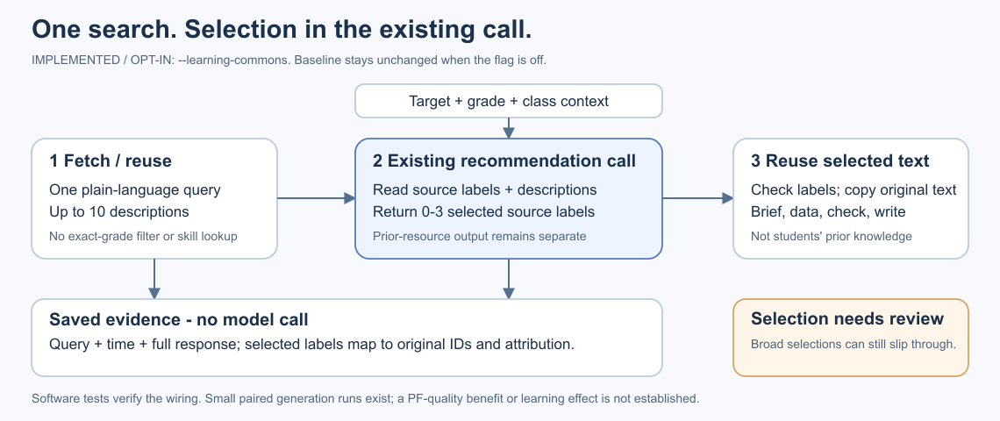
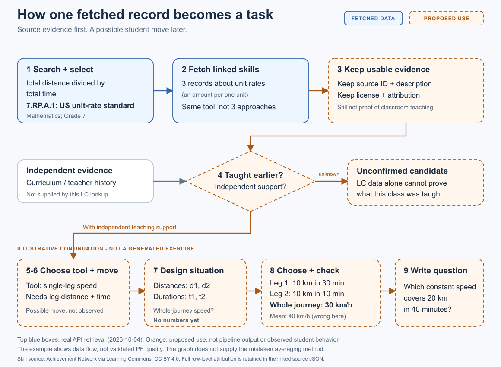

# Learning Commons -> PF: implemented optional context

Implemented on 2026-10-09 behind `--learning-commons`; the flag is off by default.
The existing recommendation call selects mathematical references separately
from its prior-resource output. No separate ranking call is added.
The current downstream default is `design_brief`: select a complete design
(D2a), propose/check concrete data (D2b), then write (D3). Implementation status
and evidence interpretation belong in [PF_PIPELINE.md](PF_PIPELINE.md).



The figure shows the current brief/data/check/write route. The October 9 paired
pilot below used the earlier route; it does not establish a Learning Commons
quality benefit for the current default.

One query uses the case's `topic`; a cache miss fetches up to ten standards with
subject filtering but no grade/jurisdiction filter. Physics maps to the API's
Science category. The standalone recommender also accepts a query override.
No linked-skill lookup is made.

The model sees short source labels, codes, jurisdictions and unchanged descriptions.
It returns `selected_sources` alongside `resources`. Target descriptions are
allowed in the reference selection; prior-teaching rules apply only to `resources`.
Code rejects missing, unknown, repeated or more than three selected labels and
copies the selected descriptions from the original response.

Only those descriptions reach the current design-brief search, selection,
data proposal/repair and writing, as well as the retained legacy plan/review/fill
route. They are separate from assumed prior knowledge and cannot override the
selected brief or frozen data meanings, units, conditions and formulas. With no prior-resource inventory,
existing task-design requirements still apply; references are not silently
promoted to student knowledge.

**Evidence:** immutable snapshots live in
`experiments/results/learning_commons_queries/cache/<request-hash>/response_<UTC>.json`.
The recommendation result embeds the raw response, retrieval time, cache status,
selection and label-to-ID mapping under `learning_commons`. Full licenses and
attribution remain in the source records, not the prompt. Cache hits work without
an API key; `--refresh-learning-commons` makes a new snapshot. Invalid caches/API
failures are reported, not converted into empty successful results.

**Run the whole pipeline:**

This opt-in command makes model calls and may fetch Learning Commons records on
a cache miss; it is not an offline validation command. Use a new output directory.

```bash
./.venv/bin/python scripts/run_pf_diagnostic.py \
  --cases kapur_average_speed_g7_singapore --model gpt41mini \
  --proposal-k 1 --max-workers 1 --learning-commons \
  --output experiments/results/validation/lc_context_pilot
```

The API helper loads the ignored root `.env`; the model client uses `.env.local`.
To generate only recommendations, use
[`run_prior_recommendations.py`](../../scripts/run_prior_recommendations.py) with
`--case CASE_ID --condition ungrounded --learning-commons`; its optional
`--learning-commons-query "plain-language phrase"` applies to one case.
Both entry points accept `--learning-commons-cache-dir`. Enabled outputs use
`prior-method-recommendations/v2`; baseline outputs stay v1.
`--from-d1` carries the saved references into the situation runner.
Reusing D1 freezes the selection and does not perform another search.

**Checks and remaining limits:** offline tests verify cache reuse, selection
validation, prompt propagation through the production gates, and unchanged
model-call counts. Writer replay freezes the selected reference block too.
[Three live development cases](../../experiments/results/learning_commons_queries/integration_calibration_20261009T142938225371Z/manifest.json)
and [two different follow-up topics](../../experiments/results/learning_commons_queries/integration_holdout_20261009T143426404153Z/manifest.json)
returned valid selections with one inventory/selection call plus one resource
expansion call per case. The live runs capped prior resources at one to test
wiring, not recommendation diversity. Physics included broad headings; broad
statistical headings still appeared after a general exclusion clarification.
Selection quality is therefore preliminary, not validated.

**Paired generation check (gpt-5.6-luna):**
[three matched baseline/context cases](../../experiments/results/learning_commons_pf_comparison_luna_20261009T151453Z/REVIEW.md)
produced 2/3 exercises in each arm. Independent arithmetic checks passed for all
four emitted tasks. Speed designs were similar; the fraction/context attempt
stopped on an ambiguous requirement; spread/context emitted a task but baseline
had a questionable range-tie rejection. Assistant inspection found no clear
consistent quality gain. This is one stochastic attempt per case and arm,
not independent human evaluation or student-response evidence.

An October 9 check reported a historical writer-replay fixture `design_context`
mismatch, also reproduced with the pre-change writer-context function. This is
a historical diagnostic, not the current test-suite status. The October 10
[saved validation summary](../../experiments/results/d2b_claim_policy_replays_20261010/final_validation_summary.json)
records 551 passing affected tests, not a full-suite run. Its three final
fixed-design tasks were ready using five data calls and three writer calls;
the two extra data calls retried invalid proposals, with zero numerical repairs.
This continuation evidence is separate from the paired Learning Commons pilot
and does not demonstrate a graph-related quality gain.

Current D2b permits at most three calls, including invalid proposals. Essential
calculated failures trigger values-only repair; essential model-judged textual
failures require design review. Unsupported or unknown calculations and
uncertain textual claims remain visible warnings and do not block writing.
Acceptance means no known essential failure, not complete verification.
D2b's agreed implementation scope is complete; student-facing design quality
and actual approach diversity remain unvalidated.

<details>
<summary>Earlier expanded speed example and code hooks (optional)</summary>

The implemented flow above replaces this earlier proposal. Linked
skills remain an optional lookup; teacher confirmation in this walkthrough is
an illustrative assumption, not a gate for including reference material.



Steps 1-2 were retrieved on 2026-10-04. Steps 3-9 show proposed transformations,
not model outputs or a pipeline run. Only selected payload fields are shown.

| Step | Concrete input | Output passed onward |
|---|---|---|
| **1. Search + select (actual)** | `query="total distance divided by total time"`; `academicSubject=Mathematics`; `gradeLevel=7`; `limit=10` | Ten matches. Select `statementCode="7.RP.A.1"`, `caseIdentifierUUID="6b9c3a21-d7cc-11e8-824f-0242ac160002"`: a US standard about unit rates, not Singapore teaching evidence. |
| **2. Fetch skills (actual)** | `GET /academic-standards/6b9c3a21-d7cc-11e8-824f-0242ac160002/learning-components?limit=5` | Three overlapping records; no further page. Trace one: `identifier="5b1f724c-bdc0-5839-9be6-9732031dc911"`; `description="Given a rate relationship between two quantities in a mathematical problem, calculate the unit rate"`. |
| **3. Adapt source data (proposed)** | That component's identifier, description, author, provider and license metadata | `evidence_id="lc:5b1f724c-bdc0-5839-9be6-9732031dc911"`; `excerpt=description` unchanged; `source="Achievement Network via Learning Commons; US 7.RP.A.1"`; `page=null`. Keep the standard/component link, license and full attribution in the saved evidence record. |
| **4. Check prior teaching (proposed)** | Target: whole-journey average speed; Grade 7; Singapore. No teacher skills supplied in this case. | These LC records alone establish **no confirmed prior teaching**. Keep the skill unconfirmed; do not feed it to expansion as a confirmed resource. Existing curriculum evidence can still be assessed separately. |
| **5. Map a resource (illustrative continuation)** | **Additional assumption, not fetched:** teacher supplies `teacher_skills=["Single-leg speed = distance / time"]`. Mapper receives target/context plus the step-3 excerpt and its evidence ID. | `resource="Single-leg rate calculation"`; `taught_as="Divide a leg's distance by its duration"`; `evidence_ids=["lc:5b1f724c-bdc0-5839-9be6-9732031dc911"]`. The mapper cites the supplied ID; it does not invent a source. |
| **6. Expand the resource (illustrative)** | Target + `resource` + `taught_as`; **not the raw API response** | `kind="builds_on"`; `student_move="Given distance and duration for the same leg, calculate its speed"`; `falls_short_because="Separate leg rates alone do not answer the combined-journey question"`. Source metadata is retained by code, not regenerated by the model. |
| **7. Design the situation (illustrative)** | The recommendation via `--from-d1`, plus the target | A number-free structure: distances `d1,d2`; durations `t1,t2`; question: one speed for the whole journey. **No numbers or story yet.** |
| **8. Choose + check numbers (illustrative)** | That structure and target rule `(d1+d2)/(t1+t2)` | Choose `d1=d2=10 km`, `t1=1/2 h`, `t2=1/6 h`. Leg rates: `20,60 km/h`; whole journey: `20/(1/2+1/6)=30 km/h`. Simple mean: `(20+60)/2=40 km/h`, wrong for these unequal durations. |
| **9. Write the question (illustrative)** | Checked quantities, question and design | "A journey covers 10 km in 30 minutes, then 10 km in 10 minutes. What constant speed would cover the same total distance in the same total time? Explain your reasoning." |

The teacher confirmation and downstream outputs are **walkthrough assumptions**.
The toy question demonstrates data flow, not validated PF quality or observed student approaches.
The graph does not supply the mistaken averaging method.

**Current hooks:** [`learning_commons_context.py`](../../scripts/learning_commons_context.py)
handles retrieval, evidence and source selection;
[`run_prior_recommendations.py`](../../scripts/run_prior_recommendations.py) adds the
selection instructions to the existing call;
[`run_situation_skeletons.py`](../../scripts/run_situation_skeletons.py) carries
selected mathematical references separately from prior knowledge;
[`design_data_stage.py`](../../scripts/design_data_stage.py) includes them in
data proposal, repair and writing.
Existing prior-resource provenance types remain unchanged.

</details>

**Real inputs:** [search results](../../experiments/results/learning_commons_queries/guided_search_20261004T154519022423Z.json)
and [linked skills](../../experiments/results/learning_commons_queries/components_7_RP_A_1_20261004T161413539208Z.json).
Linked skills: Achievement Network via Learning Commons, CC BY 4.0;
full row-level attribution is retained in the linked JSON.
