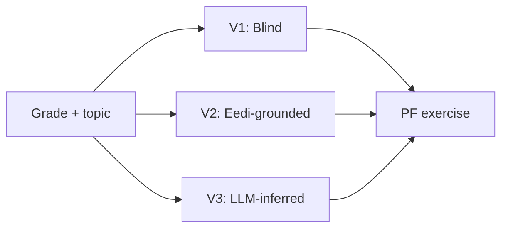
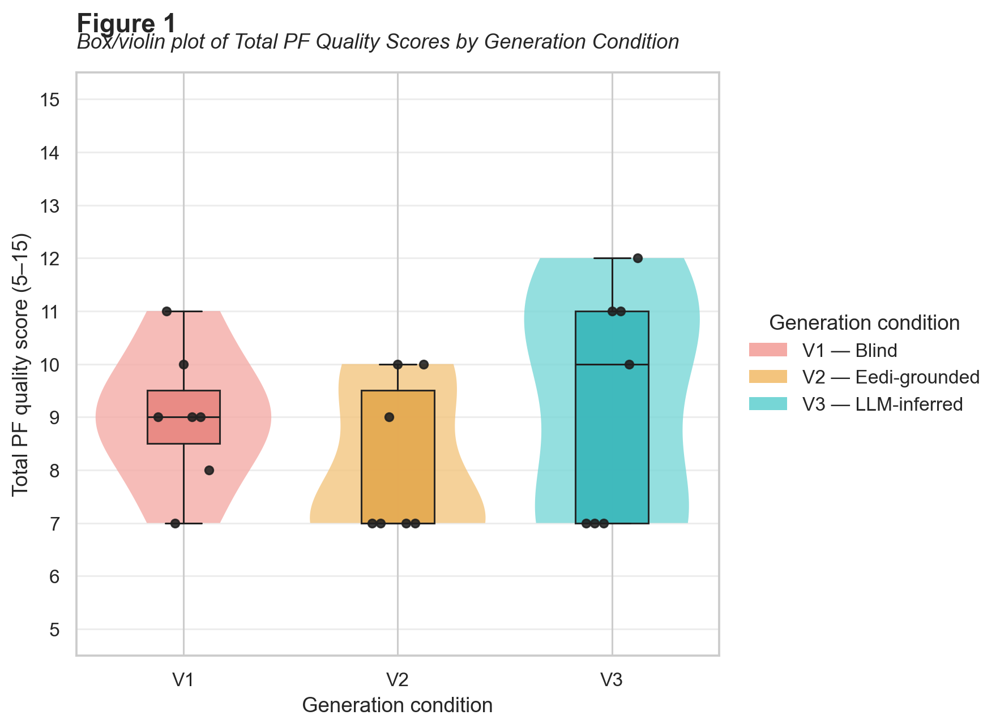
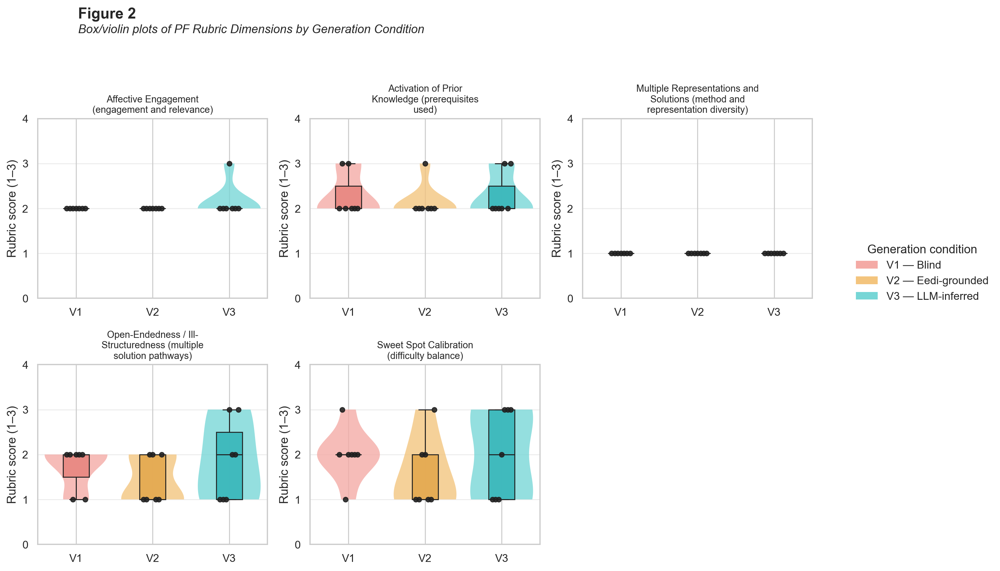
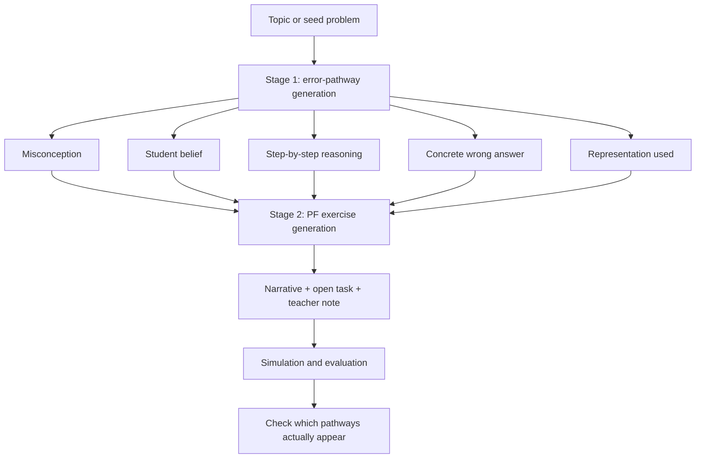
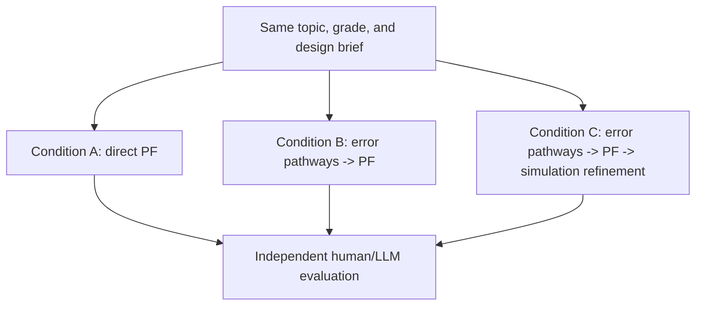

# Historical: Decomposing PF Generation

> **Archived proposal and original diagnostic results.** This note records the
> early error-portfolio-first hypothesis, not the current generation protocol or
> a completed downstream validation. Read [PF_PIPELINE.md](../PF_PIPELINE.md)
> for the current resource-first, `design_brief` -> bounded data/check/repair ->
> writing route and the October 10 evidence. Numerical checks and generated
> pathways do not demonstrate student methods, PF quality or learning.

## Research logic

This note records the reasoning behind the then-proposed generation strategy:

```text
Direct PF generation
        |
        v
V3 performs slightly better, but tasks remain shallow
        |
        v
Make student thinking explicit before writing the task
        |
        v
1. Generate concrete student error pathways
2. Generate a PF exercise around them
        |
        v
Test whether the exercise elicits multiple meaningful approaches
```

The goal is not merely to make a task look like a PF exercise. The goal is to make it **function as a PF exercise**: students should use different prior-knowledge-based approaches, encounter plausible failure, and later understand why the canonical method is needed.

---

## 1. What was tried first?

The first PF generation experiment used one common PF prompt and three sources of misconception information:



- **V1:** no misconception guidance;
- **V2:** real Eedi misconception descriptions;
- **V3:** the LLM first listed common misconceptions, then generated the exercise using its own list.

The V3 process was already a small two-step method:

```text
"What do students generally get wrong about ratios?"
        |
        v
"Now write a PF exercise about ratios."
```

This is implemented in the [PF generator](../../../src/generation/pf_generator.py) and [PF prompts](../../../src/generation/prompts/pf_generation.yaml).

> Technical note: this was direct PF generation rather than pure zero-shot generation, because the shared system prompt included fixed PF examples from the literature. V3 also used two LLM calls.

---

## 2. What did the evaluation show?

### Recorded agent-review means

The fixed DeepSeek pool contained 21 exercises: 7 briefs under each condition.

| Condition | APK | SSC | AE | MR | OE | Total |
|---|---:|---:|---:|---:|---:|---:|
| V1: Blind | 2.29 | 2.00 | 2.00 | **1.00** | 1.71 | 9.00 |
| V2: Eedi-grounded | 2.14 | 1.57 | 2.00 | **1.00** | 1.43 | 8.14 |
| V3: LLM-inferred | 2.29 | 2.00 | 2.14 | **1.00** | 1.86 | **9.29** |

Scores use the Rahimi-style 1--3 rubric. The source data are in [agent_scores_round1_deepseek.csv](../../../experiments/results/agent_scores_round1_deepseek.csv).

### Actual plot: total score



V3 is the strongest of the three in this diagnostic review, but its advantage is modest. Its median is higher and its spread is larger, not consistently high across every exercise.

### Actual plot: rubric dimensions



The most important visual signal is the flat MR panel:

```text
Multiple Representations and Solutions

V1  1.00 / 3.00
V2  1.00 / 3.00
V3  1.00 / 3.00
```

The exercises were often polished narratives with a calculation hidden inside them, rather than tasks that genuinely supported different methods, representations, and answers.

### The problem in one graph

```mermaid
xychart-beta
    title "Observed PF rubric means"
    x-axis [V1, V2, V3]
    y-axis "Score" 0 --> 3
    bar [1.00, 1.00, 1.00]
    bar [1.71, 1.43, 1.86]
```



The first series is MR. The second series is OE. The plot is not a final statistical comparison; it is a diagnostic summary of the recorded agent review.

---

## 3. What was the gap in V3?

V3 generated **generic misconception statements**, for example:

```text
Students confuse equivalent ratios with identical ratios.
Students divide by one side of a ratio instead of the sum of the parts.
Students think ratios only work with whole numbers.
```

Those statements were useful, but they were not yet executable student pathways.

### Generic versus concrete

| V3 output | Needed for the new method |
|---|---|
| "Students confuse ratios and fractions." | "The student computes 1/3 of EUR240 = EUR80 and gives the remainder EUR160." |
| "Students share equally." | "The student divides EUR240 by 2 and proposes EUR120/EUR120." |
| "Students reverse the ratio." | "The student assigns the 3-part share to the 1-part club: EUR180/EUR60." |
| Expected attempts in a consolidation note | Independently generated and testable pathways before task writing |

V3 answered:

```text
What do students generally misunderstand about this topic?
```

It did not reliably answer:

```text
Given these exact numbers, what would different students do?
How can I design a task that makes those approaches possible?
```

That is the central gap.

---

## 4. The proposed decomposition

The historical proposal makes hypothesized student thinking explicit before the
PF narrative is written. The schema and examples below are illustrative design
records, not the current MCQ or PF output contract.



### Stage 1: generate an error portfolio

This stage is inspired by the earlier MCQ distractor generator, but it should produce more than answer options.

```json
{
  "misconception": "Confuses a ratio with a fraction",
  "student_belief": "The first club receives one-third of the total money",
  "reasoning_steps": [
    "Compute 240 / 3 = 80",
    "Give the first club 80 euros",
    "Give the remaining 160 euros to the second club"
  ],
  "wrong_proposal": "80 euros / 160 euros",
  "representation": "fraction calculation",
  "plausibility": "A student who knows fractions but confuses ratio notation could produce this."
}
```

The proposed output would include both wrong and correct pathways:

| Pathway | Example for the EUR240, 1:3 task |
|---|---|
| Equal-sharing misconception | EUR120 / EUR120 |
| Ratio-as-fraction misconception | EUR80 / EUR160 |
| Reversed-ratio misconception | EUR180 / EUR60 |
| Base-plus-proportional policy | EUR80 / EUR160 |
| Correct bar model | Four blocks: one for Club A, three for Club B |
| Correct unit-rate method | EUR240 / 4 = EUR60 per ratio part |
| Correct equation | $x + 3x = 240$ |

### Stage 2: generate the PF exercise

The PF generator receives the portfolio as hidden design information. It must create a task where the approaches arise naturally, without listing the answers for students.

Example task:

> A student council has EUR240 to divide between two clubs whose membership ratio is 1:3. The council wants the division to be fair, but the students disagree about what fair means. Design a proposal, show your reasoning, and explain how you would respond to another group's proposal.

The error portfolio helps the generator check that:

- equal sharing is tempting but distinguishable from proportional sharing;
- the ratio can be represented with a bar model, table, equation, or unit rate;
- the data are consistent;
- the task supports critique and comparison, not just one calculation;
- the teacher can recognize different student pathways.

The pathways should normally remain hidden. They are **design constraints**, not multiple-choice options pasted into the exercise.

---

## 5. Why this could address the observed weakness

### Direct generation


### Decomposed generation


The difference is that the direct method asks the LLM to do two difficult things at once:

1. model how students might think;
2. design an engaging, mathematically valid, ill-structured task.

The decomposed method gives the task generator an explicit pedagogical blueprint first.

---

## 6. Proposed comparison



### Conditions

| Condition | Description | Status |
|---|---|---|
| Direct V1/V2/V3 | Existing direct PF generation conditions | Completed |
| Decomposed | Generate concrete error portfolio, then PF exercise | Proposed |
| Decomposed + simulation | Use simulated responses to revise the exercise | Proposed |

### Main hypotheses

- **H1:** Decomposition improves Multiple Representations and Solutions.
- **H2:** Decomposition improves Open-Endedness.
- **H3:** Concrete pathways reduce invalid or mathematically inconsistent traps.
- **H4:** Simulated students reproduce more distinct pathways after decomposition.
- **H5:** Overly rigid error constraints could make the task feel like a hidden MCQ; human evaluation must check for this failure mode.

### Evaluation plot to run

The following is the intended comparison, not a completed result:

```text
MR / OE quality
3.0 |                         +------------------+
    |                         | Decomposed       |
2.0 |        +---------------+| target to test  |
    |        | Direct V3      ||                 |
1.0 |--------+---------------++-----------------+
    |
0.0 +------------------------------------------------
          Direct V1/V2/V3   Decomposed   Refined
```

The actual target is not simply a higher total score. The decisive test is whether the new method moves MR and OE away from the floor while preserving mathematical validity and engagement.

---

## 7. The key distinction

The new proposal is not:

```text
Generate MCQ distractors and insert them into a story.
```

It is:

```text
Generate structured student thinking
        |
        v
Use it to design an exercise
        |
        v
Test whether real or simulated students produce those paths
```

A concise thesis formulation is:

The following preserves the early proposed formulation; it is not a claim that
students' approach diversity was measured or that this protocol is now deployed:

> Direct LLM generation produced plausible-looking PF exercises, but often failed to elicit genuinely diverse representations and solution methods. We therefore decompose generation into two stages: first, task-specific student error pathways are generated; second, an open-ended PF exercise is designed to make those pathways possible without revealing the canonical method. The resulting exercises are then evaluated for mathematical validity, open-endedness, representation diversity, and simulated-student response diversity.

---

## Source evidence

- [PF generator implementation](../../../src/generation/pf_generator.py)
- [PF generation prompts](../../../src/generation/prompts/pf_generation.yaml)
- [PF implementation notebook](../../../notebooks/04_pf_generation_implementation.ipynb)
- [PF evaluation notebook](../../../notebooks/05_pf_evaluation_round1.ipynb)
- [Recorded agent scores](../../../experiments/results/agent_scores_round1_deepseek.csv)
- [Recorded total-score plot](../../../thesis/figures/human_evaluation_total_scores_round1_deepseek.png)
- [Recorded dimension plot](../../../thesis/figures/human_evaluation_dimensions_round1_deepseek.png)
- [MCQ generator used as inspiration](../../../src/generation/mcq_generator.py)
