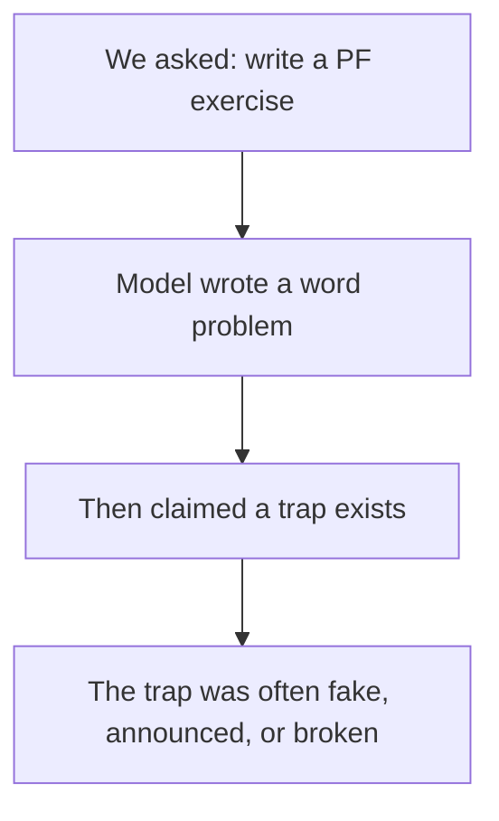
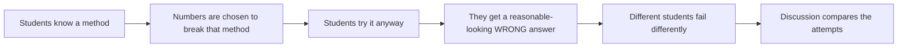
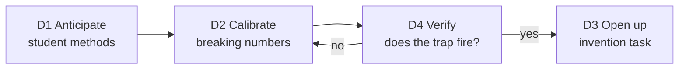
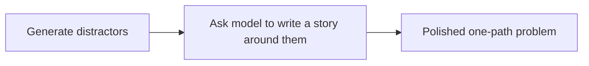
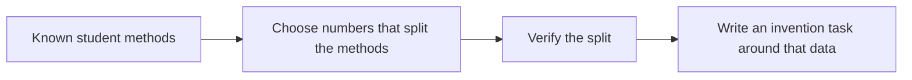
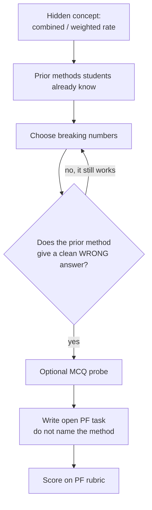

# Historical: From Error Pathways to Good PF Exercises

> This record has been consolidated into the current
> [PF_PIPELINE.md](../PF_PIPELINE.md). Keep this file for the original
> reasoning, examples, and experiment chronology.
> **Archived framework, not a current run protocol.** Current generation selects
> a design brief, proposes/checks data within three calls, and writes with fixed
> evidence. D2b is complete for the agreed implementation scope, not validated
> PF quality. The earlier requirement to make all familiar methods fail is
> superseded: successful and partial approaches can support comparison.

> How the work actually went: we built direct PF generation, measured it
> against a PF rubric, found it fails structurally, analysed what expert PF
> exercises do differently, and derived a design framework from that gap.
> This note records the reasoning, the resulting method, its limits, and
> where the MCQ work fits.

---

## 1. The research question

> **Can an LLM pipeline generate Productive Failure exercises that actually
> elicit multiple meaningful student approaches, rather than producing a
> polished story wrapped around a single procedure?**

Everything below has to earn its place by serving this question.

---

## 2. What a good PF exercise actually is

We needed a definition before we could measure anything.

A PF exercise is **not** a story with a calculation hidden inside it.

It is a problem where:

| # | Property | Plain meaning |
|---|----------|---------------|
| 1 | **The question is clear** | Students know exactly what would count as an answer. |
| 2 | **The method is not known yet** | The concept is new, so no one procedure is cued. |
| 3 | **Students already have tools** | They can start with what they learned before. |
| 4 | **Those tools look useful** | The problem looks solvable with prior knowledge. |
| 5 | **A useful limitation is available** | A declared familiar approach may fail or be unable to decide; other valid approaches can remain. |
| 6 | **Different approaches can be compared** | Different mathematical ideas matter, not merely different answer strings. Actual student use must be measured. |
| 7 | **Teaching can compare the attempts** | Consolidation uses those differences. |

> **Kapur's rule in one line:** the problem should look solvable with what
> students already know, but those resources should not be enough.

The early framing connected these properties to **Multiple Representations
and Solutions (MR)** and **Open-Endedness (OE)**. Those rubric dimensions do not
require different wrong answers or all-method failure.

---

## 3. What we did first: direct generation, and how it failed

This is where the work actually started. We built a generator, produced a
pool of exercises, and scored them blind on the five-dimension PF
rubric~\[rahimi2025\].

Three conditions, one fixed format:

| Condition | Misconception input |
|---|---|
| **V1 — Blind** | none |
| **V2 — Eedi-grounded** | real human-annotated misconceptions |
| **V3 — LLM-inferred** | the model infers its own list first |

### The result

| Condition | APK | SSC | AE | **MR** | OE | Total |
|---|---:|---:|---:|---:|---:|---:|
| V1 | 2.29 | 2.00 | 2.00 | **1.00** | 1.71 | 9.00 |
| V2 | 2.14 | 1.57 | 2.00 | **1.00** | 1.43 | 8.14 |
| V3 | 2.29 | 2.00 | 2.14 | **1.00** | 1.86 | 9.29 |

**MR sat at the floor in every condition.** Not low, not variable. Identical
at 1.00 out of 3.00. Feeding in real misconceptions did not move it.

### Reading the individual exercises

The scores said *what* failed. The rater notes said *why*.

| Failure | Example from our pool | Why it kills PF |
|---|---|---|
| **The trap is not real** | `78:52:65` reduces to `6:4:5`, so 30 bottles split exactly — no rounding conflict | Students who take the “wrong” path get the right answer. No failure. |
| **The “wrong” path is actually valid** | Same-size containers, so 4 vs 3 gallons of concentrate really is a fair comparison | The intended trap is a real, correct method. No failure. |
| **The trap is announced in the story** | A character says “add 1 to both sides” | The model tells students the mistake instead of letting them make it. |
| **The numbers are inconsistent** | 14 gallons of input but the story asks for a 12-gallon mixture | The task is mathematically broken. |



**We asked the model to write, and then hoped the numbers were a trap.**

At this point the saved pool exposed direct-generation failures, and their mechanism was
structural rather than stylistic. What we did not yet know was what the
alternative looks like.

---

## 4. What the expert examples do

So we went back to the published expert tasks from
Kapur, Loibl, Kerrigan, and Puech that we had collected in
[data/pf_exercises](../../../data/pf_exercises).

The expert tasks do **not** start with a story. They start with **data built
to break a known method**, and end with an **invention question**.

Kapur and Bielaczyc state the design move directly: they *"tweaked problem
parameters such that the problem could not be solved when students used these
very resources"*~\[kapur2012\]. That single sentence is the anchor for this
whole document.

| Expert task | Prior tool students have | How the numbers break it | The question asked |
|---|---|---|---|
| **Loibl & Puech** — most consistent player | mean, range | all players have the **same mean and same range** | “Design a measure of consistency.” |
| **Kapur** — bike to the audition | ratios | walking ratio ≠ biking ratio, so a ratio split fails | “How far should Jasmine ride so they arrive together?” |
| **Kerrigan** — divide the land fairly | simple fair share | two people both need the **same piece** (standoff) | “Describe a fair way to divide the land.” |

The Loibl data in the repository are a reconstruction, not the complete original
numerical table. The pattern below is the historical contrast-first hypothesis,
not a universal requirement that every expert task or method fails.

### The pattern behind all three



Key point: the task never says *"calculate the answer"*. It says
*"design"*, *"invent"*, *"describe"*, *"explain"* — which is what lets many
approaches appear.

---

## 5. What the comparison tells us: four design jobs

Putting our failures next to the expert exercises makes the missing pieces
explicit. Each of our four failure modes maps to something the experts do on
purpose.

| Our failure | What the experts do instead | The job |
|---|---|---|
| The trap was fake | They know exactly which method must break | **D1 — Anticipate** |
| The trap dissolved under computation | They pick parameters that provably break it | **D2 — Calibrate** |
| The task had one intended calculation | They ask an invention question | **D3 — Open up** |
| Nobody checked the trap fired | They pilot the task with real students | **D4 — Verify** |

So an exercise only *works* if four separate jobs are done:

| Job | Requirement | Plain meaning |
|---|---|---|
| **D1 — Anticipate** | Know which methods students will bring | What will they try first? |
| **D2 — Calibrate** | Choose numbers that make the attractive method fail | The trap lives in the data |
| **D3 — Open up** | Ask a question that does not name the method | "Design", not "calculate" |
| **D4 — Verify** | Prove the trap actually fires | Run every method on the numbers |



Our direct generator asked the model to do all four **implicitly, inside one
prompt**. That is why it produced the surface of a PF exercise without the
mechanism.

---

## 6. Why we did MCQ generation

Once D1–D4 were named, the bottleneck was obvious. D3 is a prompt-wording
problem. D2 and D4 are computation. **D1 is the hard one**: we cannot design
numbers that break a method until we know which methods students bring.

MCQ distractor generation is the smallest testbed where a model's picture of
student error can be produced *and checked against ground truth*.

A distractor with `faulty_step` and `reasoning_steps` makes one error-pathway
hypothesis inspectable; it is not a taught prior resource or observed PF method:

```text
"on these numbers, a student who believes X computes Y and gets Z"
```

Eedi gives human-written wrong answers with misconception labels to compare
against~\[wang2021eedi\]. No open-ended format offers that.

So the MCQ stage was an **instrument-building study**, and it produced three
things:

| Output | What we got |
|---|---|
| Can an LLM produce wrong, believable, distinct student methods? | Yes, but with trade-offs |
| Which strategy do we trust for which property? | None dominates: retrieval is realistic, forced labels are diverse |
| How do we *measure* wrong / believable / distinct at all? | The three checks plus pairwise diversity |

The second and third matter more than the first. The metrics are **reusable
instruments**, and they turn out to be exactly what D4 needs. The trade-off
tells us there is no single best source of student methods.

---

## 7. The core shift: numbers first, then writing

A good PF is built in this order:

| Step | What you do |
|------|-------------|
| 1 | Start from a **concept** (and optionally a closed question that already carries it). |
| 2 | List the **prior methods** students will try first. |
| 3 | Choose **numbers that break those methods**. |
| 4 | **Verify** that each method really fails, and that different methods give different answers. |
| 5 | Write the **question** as an invention task. |
| 6 | Add the **story last**, so it does not reveal the trap. |

This list records the early numerical-contrast protocol. Current design starts
with a complete goal and relationships before data selection; only declared
essential numerical failures require repair. Not every approach must be
computable or fail, and behavioral diversity cannot be verified by answer
separation alone.

Our old method was the opposite:

```text
Old:   write story  →  hope for a trap  →  list mistakes afterwards
New:   design data  →  verify the split →  write the task around it
```

---

### Why it must be like this

Three reasons, each backed by evidence we already have:

| # | Reason | Evidence |
|---|---|---|
| 1 | **The trap is a property of the numbers** | Every expert exercise encodes it there: mismatched ratios~\[kapur2012\], same mean and range~\[loibl2014\], the standoff matrix~\[kerrigan2021\] |
| 2 | **LLMs do not do D2 spontaneously** | Our 21-exercise pool: traps that dissolve under computation, traps that were valid methods, numbers contradicting the story |
| 3 | **More prompting does not buy the mechanism** | MCQ over-constraint result: the heaviest prompt produced the *most* accidentally-correct answers |

Reason 3 is the important warning. Stacking PF theory into the prompt is the
same move that already failed once.

---

## 8. How to generate a good PF (the practical pipeline)

### Step A — Start from a concept

Example: students are about to learn **sharing in a given ratio**. They already
know equal sharing, fractions, and simple multiplication. The concept can come
from a topic list, or from a closed Eedi question. We do not need a seed
question, but a seed question is one convenient way to get the concept and a
first set of numbers.

### Step B — List the prior methods

This is where the distractor/pathway work is useful — **not** as options to
paste into the exercise, but as a list of methods students will reach for:

- split equally
- use range
- use mean
- treat `1:3` as `1/3`
- add the same amount to both sides

### Step C — Build numbers that break the attractive methods

The actual design step.

| If students will use… | Then make… |
|---|---|
| mean and range | mean and range the **same** for everyone (Loibl) |
| simple ratios | the two ratios **not match** (Kapur) |
| equal split | equal split look fair but give a clearly different result |
| additive scaling | adding the same amount break the ratio (lemonade) |

### Step D — Test the trap before writing prose

For each listed method, **compute the answer** on those numbers.

A trap is real only if:

- [ ] the method produces a definite answer
- [ ] that answer looks reasonable
- [ ] that answer is wrong, or cannot decide the question
- [ ] at least two methods give **different visible outputs**

If two methods give the same number, inspect their reasoning rather than
assuming they are identical.
If a supposedly wrong method is correct, correct the claimed contrast; the
task may still offer productive comparison.
If the numbers are inconsistent → junk.

This check can be done by code or a second model. No classroom needed yet.

### Step E — Write the question as an invention

| ❌ Bad | ✅ Good |
|---|---|
| “Figure out exactly how many dollars each club should receive.” | “Design a fair way to split the money. Show why your method is fair, and why another group's method is not.” |
| “Calculate the answer.” | “Design as many different measures as you can. Each must use all the data.” |

### Step F — Add the story last

The story only makes the situation feel real.

It must **not** tell students the wrong method.

> Our lemonade exercise failed here: a character already said “add 1 to both.”
> That turns a PF exercise into a prompted error.

---

## 9. From distractors → PF, done right

The useful part of a distractor is **not** the wrong answer string.

It is the **method** behind it:

```text
"student divides the total by each side of the ratio"
        ↓ becomes a design constraint
"choose numbers where this method gives a clean but wrong allocation"
```

### Wrong pipeline (what we did)



### Right pipeline



---

## 10. A 4-question test for any new generator

Before scoring APK / AE / story quality, ask only these four questions:

1. **What prior method is supposed to fail?**
2. **If I run that method on the numbers, does it actually fail?**
3. **Do at least two methods give different visible outputs?**
4. **Is the student asked to invent a method, or just compute one number?**

These were contrast-screening questions, not universal acceptance gates. A
known false essential numerical contrast needs repair; a correct alternative,
unsupported approach prediction or missing behavioral evidence is not itself
proof that the exercise is invalid.

---

## 11. Full theoretical flow, with one example

> **Historical illustrative example with a modeling defect.** The numbers below
> compute a person-weighted mean of individually observed speeds, not the speed
> of a joined group walking together. Without a movement model, the claimed
> joined-group speed is undefined. The arithmetic is retained for chronology;
> do not reuse its task text as a mathematically validated PF exercise.
> Current speed evidence concerns fixed journeys and is compared with Kapur's
> unknown handover-point task in [PF_PIPELINE.md](../PF_PIPELINE.md).

The 240 euro / 1:3 club example is **too weak**. Different ideas of fairness
give different answers, but no prior method actually *breaks*. Equal split
still works as a complete answer. That is just an open discussion, not a PF
trap.

A real trap needs two named things:

| Term | Meaning | In this example |
|---|---|---|
| **Prior method** | A tool students already know and will try first | average the two rates: `(fast + slow) / 2` |
| **Breaking number** | A number choice that makes that tool fail | the two groups have **different sizes** |

If the groups had the same size, the simple average would be correct. The
unequal sizes are the breaking number.



### 11.1 Hidden concept

Students are about to learn **combined rate / weighted rate**.

Example question they cannot yet answer well:

> Class A walked 4 km/h. Class B walked 12 km/h. If they walk together as one
> group, how fast is the group?

The new idea is: you cannot just average the two speeds. The bigger class
pulls the combined speed toward its own speed.

### 11.2 Prior methods (D1)

These are tools Grade 7 students already have. They are **not** the new
concept.

| Prior method | What the student already knows | What they will do here |
|---|---|---|
| Simple average | “Average means add and divide by how many” | `(4 + 12) / 2 = 8` |
| Use the bigger number | The faster class should decide | `12 km/h` |
| Use the smaller number | The slower class holds everyone back | `4 km/h` |
| Ignore group size | Two classes, so two numbers | same as simple average |

The method we want to **break** is the first one: simple average.

### 11.3 The breaking number (D2)

The simple average fails only when the groups have **different sizes**.

**Bad numbers** (no trap):

```text
Class A: 10 students at 4 km/h
Class B: 10 students at 12 km/h
```

Simple average: `(4 + 12) / 2 = 8`  
True combined rate: also `8`  
The prior method still works. Do not keep these numbers.

**Good numbers** (the trap):

```text
Class A:  4 students at 12 km/h
Class B: 12 students at  4 km/h
```

Now compute each method:

| Method | Calculation | Result | What happens |
|---|---|---|---|
| Simple average | (12 + 4) / 2 | **8 km/h** | looks right, is wrong |
| Use the faster class | take 12 | **12 km/h** | ignores the large slow group |
| Use the slower class | take 4 | **4 km/h** | ignores the small fast group |
| Correct weighted rate | (4×12 + 12×4) / 16 = 96/16 | **6 km/h** | the large slow group pulls it down |

The breaking number is **4 vs 12 students**.

That is the Kapur move: students will use a tool they already trust. On these
numbers that tool gives a clean answer. The answer is wrong.

### 11.4 Optional MCQ probe on the same numbers (D4)

Closed form of the same data:

> Class A has 4 students walking at 12 km/h. Class B has 12 students walking
> at 4 km/h. They join into one group. What is the group’s speed?

A useful probe would produce:

| Answer | Method | Keep? |
|---|---|---|
| 8 km/h | simple average | yes, this is the main trap |
| 12 km/h | use the faster class | yes |
| 4 km/h | use the slower class | yes |
| 6 km/h | correct | reject as a distractor |

If the probe never produces 8 km/h, the simple-average trap may not be
natural on these numbers. Try another set.

The historical proposal gave an MCQ probe these roles:

1. Find the prior methods.
2. Check that the breaking numbers really make them fail.
3. Warn us if a method is not student-like.

Model-generated probes do not prove students will use the error, and a missing
generated error is not grounds by itself for rejecting the task. Mathematical
checks and behavioral plausibility are different evidence.

It does **not** write the PF exercise.

### 11.5 Write the PF exercise around those numbers (D3)

Do not say “use a weighted average.” Do not say “do not just add and divide
by 2.” The sizes and speeds are facts. The question is open.

**TOPIC**  
7th grade, ratios and rates, two classes walking together

**NARRATIVE**  
Two classes go on a walk and later join into one group. Class A has 4
students and walks at 12 km/h. Class B has 12 students and walks at 4 km/h.
The PE teacher needs one speed for the whole group, because the bus will
meet them at that speed.

**TASK**  
Decide how fast the joined group is walking. Show your method, and explain
why another group’s method might give a different speed.

**CONSOLIDATION NOTE** (teacher only)

| Expected attempt | What they write | Why it fails / works |
|---|---|---|
| Simple average | 8 km/h | treats the two classes as equal, but 12 students vs 4 students |
| Faster class | 12 km/h | ignores the large slow group |
| Slower class | 4 km/h | ignores the small fast group |
| Correct | 6 km/h | 4×12 + 12×4, then divide by 16 people |

The student text never lists these answers.

### 11.6 Why this is a PF trap, and 240 / 1:3 was not

| | Weak example: 240 euros, 1 and 3 members | This example: 4 students at 12, 12 students at 4 |
|---|---|---|
| Prior method | “fair means equal” | “average means add and divide by 2” |
| Does that method break? | No. 120/120 is a complete fair plan | Yes. 8 km/h looks right and is wrong |
| Breaking number | none | the group sizes are different |
| If we change the numbers | 1:1 makes equal split correct | equal class sizes make 8 km/h correct |

Different answers are not enough. The prior method must **fail on the
numbers**.

### 11.7 If a later number set fails

Suppose we try 10 students at 6 km/h and 10 students at 8 km/h.

Simple average = 7. Weighted rate = 7. The prior method still works. Do not
write a story around it. Go back and change the sizes.

---

## 12. Where MCQ generation helps

Four roles, all **around** the PF generator. Never inside its prompt.

| Role | Job | What it does | Which finding backs it |
|---|---|---|---|
| **Discover** | D1 | Produce concrete candidate methods for a concept | Structured pathways work; bare labels do not |
| **Verify** | D4 | Close the numbers into a question, probe whether the trap fires | The trap-check catches all four failure modes from §5 |
| **Measure** | D4 | The incorrect / plausible / coherent / distinct checks transfer to pathway portfolios | Metric-family design |
| **Warn** | D2, D3 | Tells us which strategy to trust for what | The trade-off and over-constraint results |

And one **anti-role**:

> MCQ output is **not** input text for the PF writer.
> That is V2 again, only with more words.

### The findings, translated into design rules

| MCQ finding | Rule for PF generation |
|---|---|
| No prompt wins on everything | Do not pick one \"best\" method and feed it in. Matching human answers and covering many methods are different jobs |
| Retrieval copies common errors | Good for \"is this a real student move?\". Weak for \"are there many routes?\" |
| Forced labels create extra variety | Some of that variety is **fake**. Fake variety is dangerous: the task looks open and still fails |
| Extra constraints make answers less wrong | Keep the PF prompt short. The numbers carry the trap, not the instructions |

---

## 13. Restrictions

Being honest about what this framework cannot claim.

| Restriction | What it means |
|---|---|
| **Numerical checking has limited scope** | Exact checks can test computable conditions. Qualitative, diagrammatic and algebraic attempts remain legitimate approaches; unsupported checks stay unknown, not failed. |
| **D1 is only as good as its source** | Historical method lists used Eedi/model hypotheses; current D1 uses curriculum/textbook resources with expert lists held out. Neither source establishes classroom behavior. |
| **Breaking numbers give solution diversity, not representation diversity** | Different wrong *answers* is not the same as bar model vs table vs equation. MR may still need task-form work~\\[puech2025\\] |
| **Early topic scope** | This original diagnostic concerned ratios and rates, Grade 7. Later topic-diverse pilots are recorded in the canonical pipeline note, not retroactively added to this pool. |
| **Simulated verification \u2260 student behaviour** | The MCQ probe is model self-agreement. It filters obvious failures cheaply. It does not prove students take those routes |

---

## 14. How this is grounded in prior work

Each design job maps to existing literature. The gap is where the
contribution sits.

### D1 \u2014 Anticipate student methods

| Claim | Source |
|---|---|
| Teachers anticipate the full set of student solutions, errors included, before the lesson | `stein2008` \u2014 anticipation is the first of the Five Practices |
| Japanese lesson plans contain a written table of anticipated student responses | `fujii2016` |
| Known misconceptions can be explicit design input for lessons | `bell1993` \u2014 diagnostic teaching |
| LLMs can generate distractors mirroring real student errors | `feng2024`, `alhazmi2024` |

### D2 \u2014 Breaking numbers

| Claim | Source |
|---|---|
| *\"We tweaked problem parameters such that the problem could not be solved when students used these very resources\"* | `kapur2012` \u2014 the anchor quote |
| Same mean and range, so both prior tools provably fail | `loibl2014` |
| The standoff is engineered into the value matrix | `kerrigan2021` |
| Contrasting cases: only the target feature discriminates | `schwartz2004` |

### D3 \u2014 Open task form

| Claim | Source |
|---|---|
| Ill-structured problems afford multiple RSMs and require assumptions | `jonassen2000` \u2014 the definition Kapur cites |
| \"Design as many different measures as you can\" as an explicit breadth prompt | `puech2025` |
| Complexity is a relation between problem and solver, not the problem alone | `kapur2012` |

### D4 \u2014 Verification, and why diversity is the outcome

| Claim | Source |
|---|---|
| The **number** of student-generated solutions predicts learning outcomes | `kapur2014` \u2014 makes RSM count a legitimate primary outcome |
| Intent-labelled tutoring lifts RSM count from 1.0 to 2.6 | `puech2025` |
| LLM judges are lenient and biased, so verification cannot rest on one judge call | `zheng2023judging`, `liu2023geval` |

### The gap that stays a gap

The original literature review did not identify work using generated error
pathways to select and verify the numbers of an open-ended task; this is not
an exhaustive verified absence claim. The closest anchors considered were `bell1993`
(misconceptions as design input, but for closed tasks) and `kapur2012`
(parameter-breaking, but done by hand from pilots).

> The contribution: automate what Kapur did by piloting, and what Bell did by
> annotation.

---

## 15. How the grounding layer plugs into D1

The pathway framework says D1 needs a list of prior methods students will
reach for. The August implementation built a mechanism that proposed that list with
checkable provenance. This section records how the two pieces connect.

### The mechanism that exists

The grounded/ungrounded prior-resource recommender
([run_prior_recommendations.py](../../../scripts/run_prior_recommendations.py))
implemented the input side of D1 as follows in the historical run:

```text
target concept + grade + topic + (teacher's "recently taught" skills)
    │
    ├─ ungrounded: model free-lists resources → provenance = model
    │
    └─ grounded: retrieve curriculum pages + curated paper cells
                 → map evidence to taught-skill labels
                 → expand each into first move + specific shortcoming
                 → provenance = curriculum page / paper reference
```

Every recommendation carries:
- **resource** — the taught-skill label (the D1 candidate)
- **student_move** — the first thing a student does with it (the D1 behavior)
- **falls_short_because** — the specific gap (the D2 design target)
- **provenance** — which document and page, or explicit `model`

The `falls_short_because` field is the handoff to D2: it names the exact way
the prior method fails, which is what the trap calibration must break.

### Historical grounded versus ungrounded design choice

Both conditions produce the same schema, so they can be compared directly.
The grounded condition is the default for any claim we intend to defend in
the thesis, because its outputs are checkable against a source. The
ungrounded condition is the baseline that shows what the model invents when
left to its own priors — and on the expert cells it misses most of the
documented prior resources.

A count cap (`--max-resources`, default 5) keeps the list focused, and
provenance-ranked truncation ensures the strongest evidence survives when the
model overshoots.

### What this enables for the pathway build

| D-step | Input from the recommender | What it unlocks |
|---|---|---|
| D1 Anticipate | resource + student_move + provenance | A defensible list of what students bring |
| D2 Calibrate | falls_short_because per resource | The specific gap each trap must exploit |
| D3 Open up | (not from this component) | Task-form design stays separate |
| D4 Verify | provenance field | Each recommendation can be traced to a source |

### Open items recorded at that point

- **Scale the comparison.** The grounded vs ungrounded uplift is currently
  n=3 cells. A defensible claim needs all 7 expert cells, both models, and at
  least one cell with no curated paper list (the true retrieval test).
- **Add `[tempting_mistake]` from Eedi.** The current build emits
  `[builds_on]` only. The scraped Eedi quizzes are the evidence source for
  the second recommendation category.
- **Wire into D2.** The `falls_short_because` strings are the input the
  trap-design step needs; connecting the recommender output to the number
  search is the next implementation step.
- **Human validation.** Recall tells us we found the documented resources; a
  teacher rating tells us the recommendations are actually usable.

**Current boundary:** curated expert records are now held out, and resource
expansion describes the objects needed to start rather than a full student
method. Recommendations already feed downstream design briefs. Optional
Learning Commons references remain separate from prior-teaching claims. The
October 10 bounded data/check loop is complete for its agreed scope; improving
student-facing tasks and evaluating actual approaches remain open. Do not
read the older three-cell resource preservation as independent recovery.

---

## 16. Historical proposed next build

A small generator, not a new theory:

1. Fix one topic (ratios, or consistency).
2. Fix 3\u20135 prior methods from our pathway work.
3. **Search or sample number sets** until those methods split.
4. Only then generate the narrative.
5. Keep exercises only if the 4-question test passes.
6. Compare against direct generation (Rahimi-style) on the same rubric.

### What a success would look like

| Dimension | Direct (old) | Decomposed (target) |
|---|---|---|
| MR | ~1.00 / 3.00 | ≥ 2 / 3 |
| OE | ~1.71 / 3.00 | ≥ 2 / 3 |
| SSC | ~1.90 / 3.00 | stays ≥ 2 / 3 |

### What a failure would still mean

If MR / OE stay low even with the trap-first method, that is still a result:

> Current LLMs can write PF-looking stories, but they do not build the data
> trap that makes PF work. That is an analysis of where and why LLMs fail at
> the real task of PF generation.

---

## The one-sentence takeaway

> **Good PF generation is number design, then writing.**
> We were doing writing, then hoping the numbers were a trap.
