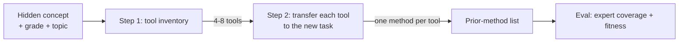

# Historical: Prior-Methods Generation - Step-by-Step Execution (v5)

> This detailed execution record is retained for provenance. Read the current
> [PF_PIPELINE.md](../PF_PIPELINE.md) first.

> Review document. This describes **the historical v5 benchmark**, step by step,
> with its prompts and a saved example. Later teacher-facing recommender decisions
> are preserved below as part of the improvement journey, not a current run guide.
>
> Implementation: [run_curriculum_methods.py](../../../scripts/prior_methods/run_curriculum_methods.py)
> Prompts: [prior_methods.yaml](../../../src/generation/prompts/prior_methods.yaml)
>
> **Status:** historical v5 implemented and run (all 10 concepts × 4 models, judged by
> gpt-5.6-luna). Current D1 uses curriculum/textbook excerpts with curated expert
> lists held out, rather than the earlier curated-record-preserving route.
> Current downstream generation uses design briefs, checked data and writing;
> status and evidence limits are recorded in [PF_PIPELINE.md](../PF_PIPELINE.md).

## The pipeline in one diagram



One inventory call, then one transfer call per tool. Total per concept is
approximately 1 + (4-8) calls, before the separate evaluation.

---

## Step 1 — Tool inventory (curriculum recall)

**Input:** `grade`, `topic`, `concept_text` from a concept package
(e.g. [c4_partwhole.json](../../../experiments/data/prior_methods_benchmark/c4_partwhole.json)).

**System prompt (verbatim):**

> You are a curriculum expert listing the mathematical tools a student has already been
> taught BEFORE a given concept. List only genuinely taught, correctly-executable tools
> (operations, facts, standard procedures, heuristics from earlier units). Do not list
> errors or misconceptions. Do not list the target concept itself or anything that
> requires it.

**User prompt (verbatim, `{...}` = filled from the package):**

> A grade {grade} student is about to learn the following concept in the topic "{topic}".
> They have NOT yet been taught it.
>
> HIDDEN CONCEPT: {concept_text}
>
> List the prior mathematical tools this student has already mastered that could be brought
> to bear on tasks of this topic. For each tool give: "tool", "taught_as", "relevance".
> Return JSON only: {"tools": [ ... ]}. Aim for 4-8 tools.

**What it produces (c4_partwhole, gpt-5.6-luna):**

| tool | taught_as |
|---|---|
| Fraction as a part of a whole | a/b = a parts out of b equal parts |
| Addition of whole-number parts | add same-unit quantities for a total |
| Division as sharing or grouping | split into equal shares |
| Fraction notation as division | a/b means a ÷ b |
| Equivalent fractions | multiply top and bottom by same number |
| Multiplying a fraction by a whole number | (a/b)×c = (a×c)/b |
| Simplifying fractions | divide top and bottom by GCF |

**Design intent:** list *taught, correctly-usable resources* — not errors.

---

## Step 2 — Transfer each tool to the new task

For **each** tool from Step 1, a separate call.

**User prompt (verbatim):**

> A grade {grade} student is about to learn a new concept but has NOT yet been taught it.
> They face a task of this topic.
>
> HIDDEN CONCEPT: {concept_text}
> TOPIC: {topic}
>
> One prior tool the student knows: Tool: {tool} / Taught as: {taught_as}
>
> Describe, from the student's point of view, how they would apply THIS tool to a task of
> this topic, and what result it produces. Then state how it falls short for the concept.
>
> Return JSON: {prior_method, taught_as, what_student_does, why_it_looks_applicable,
> falls_short_because}

**What it produces (one example, c4, tool = "Fraction as a part of a whole"):**

```json
{
  "prior_method": "Fraction as a part of a whole",
  "what_student_does": "The student treats the ratio 5:3 like the fraction 5/3 ...",
  "why_it_looks_applicable": "...",
  "falls_short_because": "In 5:3, both numbers describe separate parts ... the whole is 8 parts, so the first part is 5/8, not 5/3."
}
```

**Design intent:** each tool is *run forward* on the new task and its shortcoming named.

---

## What the output list looks like (c4, full)

| # | prior_method | the move the student makes |
|---|---|---|
| 0 | Fraction as a part of a whole | read 5:3 as 5/3 |
| 1 | Addition of whole-number parts | compute 5+3=8 |
| 2 | Division as sharing or grouping | read 5:3 as 5/3 (divide) |
| 3 | Fraction notation as division | read 5:3 as 5/3 |
| 4 | Equivalent fractions | read 5:3 as 5/3, then rescale |
| 5 | Multiplying a fraction by a whole | read 5:3 as 5/3, then × whole |
| 6 | Simplifying fractions | read 5:3 as 5/3, then reduce |

---

## The evaluation step (separate)

- **Coverage** (expert-anchored concepts only: c4, x_avgfreq, x_range): for each expert-anticipated method, is it covered by any generated method? Judge = gpt-5.6-luna.
- **Fitness** (all methods): is the `falls_short_because` claim correct / wrong / vague?

---

## Historical open problems and resolution

These were flagged from the historical v5 review of c4.

1. **Redundancy by shared first move.** Six of the seven c4 methods are the *same* move
   (read 5:3 as 5/3). Step 1 invents topic-surface tools; Step 2 funnels them into one
   application. No dedup happens on the underlying move.
   → Candidate fix: after Step 1, group tools by "the first action a student takes"; merge
     tools with the same first action into one prior method *before* Step 2.

2. **Implausible / chained applications.** "Multiplying a fraction by a whole number"
   (5/3 × 40) is a *second* tool stacked on the first; a student would not run it as their
   opening move. Step 2 lets tools chain.
   → Candidate fix: constrain Step 2 to the *first* action only; a tool that requires another
     tool's output first is not a valid opening method.

3. **Heuristic layer missing.** On c4 the expert list is dominated by problem-solving
   strategies (diagrams, trial-and-error, LCM) that the tool inventory never produces.
   → Deferred in the benchmark doc (§8, limitation 0); revisit only if D1 must serve
     ill-structured tasks.

The subsequent recommendation redesign addressed these problems with evidence
selection, filtering, deduplication and shorter expansion. Current expansion
describes what objects a tool needs to start and the target's additional demand,
not a full first-move solution. These changes do not establish completeness or
observed student behavior; heuristic and representation coverage remain limitations.

---

## Where the c4 review led: redesign the input, not the dedup

The three problems above share one root cause, found by asking **who the input is for**:
Step 1 generates "prior tools" from only a topic label, so it defaults to a textbook table
of contents — many tool names that collapse to one student move. Dedup after the fact
(open problem 1) treats the symptom. The redesign below targets the cause.

### The teacher's actual input

A teacher designing a PF task does not list misconceptions or a curriculum tree. They know
**the concept they are about to teach** and **what they just taught**. The input is:

```text
what we are teaching    (the hidden concept)
+
what we just taught     (the immediately preceding skills)
```

and the generation question becomes: *"Given they just learned X, what will they reach for
on this new task, and how does it fall short?"*

### The abstraction level (where each party lives)

| Level | Example (c4) | Supplied by |
|---|---|---|
| Curriculum label / taught skill | "Fractions as part of a whole" | **teacher input** |
| First move | "read the two numbers as a fraction" | model (Step 2) |
| Specific instance | "read 5:3 as 5/3" | model (Step 2) |

The teacher works at the **taught-skill label** level — a short, real list they actually
know. The model expands each confirmed skill into the move it triggers and its failure.
This was intended to reduce redundancy at the source by anchoring the inventory
to taught skills. It was a design rationale, not a guarantee that different
resource labels produce distinct student methods.

### Suggesting "recently taught" from the other side

The teacher should not face a blank box. The system **recommends** candidate
recently-taught skills; the teacher confirms, edits, or adds their own. Two filters apply:
a suggestion must be both **preceding** (taught before) and **relevant** (a student could
plausibly reach for it here). That yields two kinds of suggestions, kept visually distinct:

```text
[builds on]        direct prerequisites — correct-but-insufficient tools
                   (from curriculum sequence / scope-and-sequence)
[tempting mistake] transfer temptations — look applicable but are not
                   (from Eedi observed errors + model forward-probe)
```

The proposed two-category interface distinguishes legitimate tools from tempting
misapplications. Not every PF design requires a wrong first move, and valid
methods need not be prohibited. The categories were design proposals, not evidence
that students would take those approaches.

**Honest gaps:** (a) "what we just taught" remains an optional teacher input; (b) the
`[builds on]` recommender now uses curriculum/textbook evidence without the expert
paper lists in its generation prompt, while the
`[tempting mistake]` tab remains intentionally deferred because it has no clean ground
truth.
