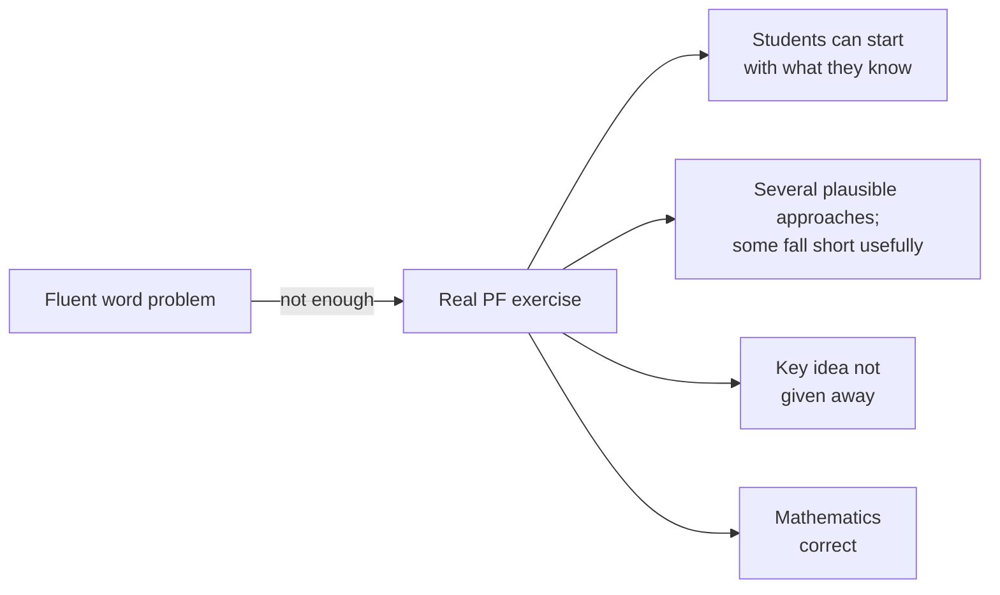
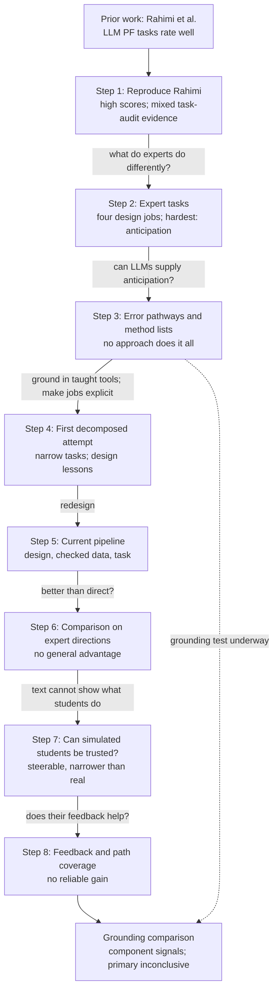
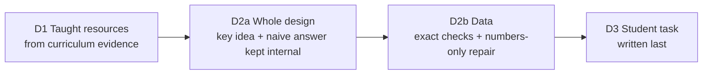
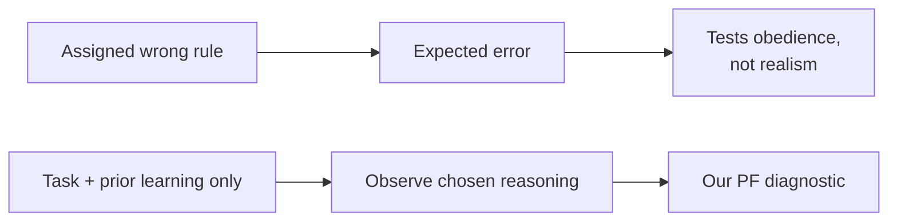
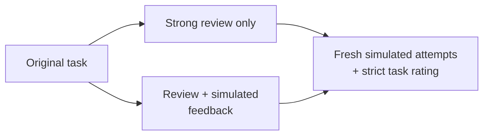
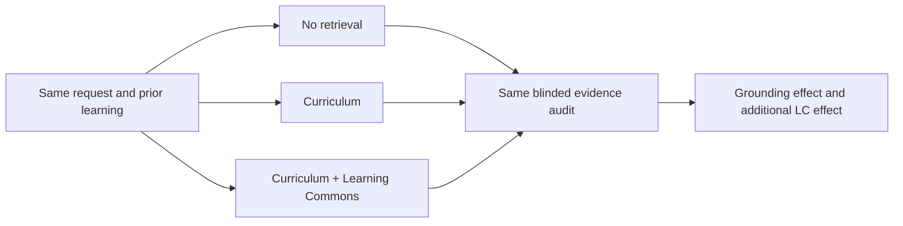
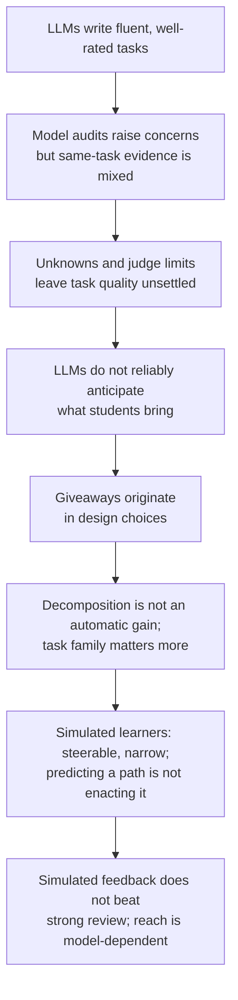
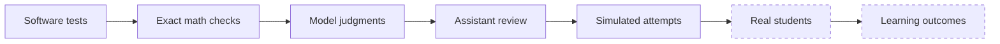

# Thesis Overview

**Working overview, October 13, 2026.** This document tells the thesis as one
logic chain: what was already known, what we asked, why each step followed from
the previous one, what we found, and what comes next. It summarises existing
records and does not replace them. Exact protocols, numbers and caveats live in
[PF_PIPELINE.md](../pf-generation/PF_PIPELINE.md) (canonical PF record),
[THESIS_STATUS.md](THESIS_STATUS.md) and the
[MCQ evaluation overview](../mcq/MCQ_EVALUATION_OVERVIEW.md). Steps follow the
logic of the argument, not the calendar.

**Official title (unchanged):** *PF Generation: Can an LLM pipeline with
simulated-student-driven refinement generate Productive Failure exercises that
approach expert quality?* The title asks a question; the thesis answers it
honestly, including where the answer is negative or qualified.

---

## 1. Purpose and framing

This is a **diagnostic thesis**. It asks what large language models (LLMs) can
and cannot do when they design **Productive Failure (PF)** mathematics
exercises, and what that tells us about using LLMs in education. Generating PF
exercises is the lens. The generation pipeline, the error-pathway (MCQ) study
and the simulated students are research instruments.

In PF, students tackle a problem *before* being taught the method. A good PF
exercise is therefore more than a hard word problem:

---

## 2. Starting point: prior work

Each strand of prior work gives a base and leaves a gap.

| Prior work | What it already shows | Gap this thesis addresses |
|---|---|---|
| Kapur; Kapur and Bielaczyc (2012); Loibl; Kerrigan | How human experts design PF tasks, with published examples (bicycle handover, most consistent player, fair land division) | No automatic way to produce such designs |
| **Rahimi et al.** | LLMs can generate PF math problems that rate well on a five-dimension rubric | Whether well-rated tasks actually contain the PF mechanism |
| Feng et al. (2024) and distractor research | LLMs can generate wrong answers that partly match real student errors | Which generation approaches give plausible *and* different mistakes, as design material for PF |
| Liu et al. (2023); Lu and Wang (2024) | LLMs can role-play students and support question evaluation | Whether simulated students can help improve *PF task design* |

Our base is **Rahimi et al.'s setting and rubric**: Grade 7 proportional
relationships; five 1--3 dimensions (prior knowledge, challenge fit,
engagement, multiple representations and solutions, open-endedness); and a
reconstruction of their direct-generation prompt.

---

## 3. Research questions

**Main question.** What can LLMs do, and where do they fail, when designing PF
exercises that should elicit several meaningful student approaches rather than a
polished story around one procedure, and what does this imply for using LLMs in
education?

| # | Sub-question | Status |
|---|---|---|
| RQ1 | Starting from Rahimi et al.'s setting, do well-rated LLM PF tasks actually contain the PF mechanism? If not, where do they fail? | Qualified model evidence; human and student validation open |
| RQ2 | Which prompting and retrieval approaches generate wrong answers with plausible student reasoning and meaningfully different mistakes? | Answered |
| RQ3 | Does decomposing PF design into explicit, checked steps produce better exercises than strong direct prompting? | Answered |
| RQ4 | Can simulated students help improve PF task design: do they reach the designed approaches, and does their feedback improve tasks? | Answered |
| RQ5 | Does grounding generation in curriculum evidence about what students were taught improve PF exercises, and does Learning Commons add a benefit? | **Completed pilot; primary outcome inconclusive** (Section 6) |

**Scope notes.**

- **RQ2** asks what the MCQ study measured. Its link to PF is motivation: such
  error pathways could inform what students might try. It is not shown that
  feeding them into PF design improves exercises.
- **RQ4** is deliberately narrow. Simulated students are a research field of
  their own; we ask only whether they help improve real task design and
  validate them only as far as that use needs.
- **RQ5** follows from Step 3, where grounding was adopted as a design decision
  without a measured effect. The October 12--13 campaign holds the D1 learner
  packet fixed and compares no added references, local curriculum references,
  and local curriculum plus Learning Commons references. It tests evidence
  availability during task design, not prior-resource discovery.

---

## 4. The logic chain

Each step answers a question raised by the previous step. The dashed box is the
active grounding study; its task-quality result is not yet available.

---

## 5. Completed steps

### Step 1 -- Reproduce and extend Rahimi et al. (RQ1)

**Why.** Rahimi et al. showed that LLM-generated PF problems rate well. Before
building anything, we needed to know whether good ratings mean the tasks work
as PF.

**What we did.** We generated tasks in Rahimi's setting with a direct prompt and
extended it with misconception input: V1 without misconceptions, V2 with real
Eedi misconception labels, V3 with LLM-inferred misconceptions. Two early
model-based checks used separate task sets. A later audit rated the same saved
v4 tasks under a frozen, condition-blind protocol.

**What we found: early warnings, but no paired confirmation.**

| Check | Task set | Result |
|---|---|---|
| LLM judge with Rahimi's rubric | 9 development exercises | **6 of 9** received the maximum **15/15**; all 9 received the maximum challenge-fit score |
| Blind AI review with the same rubric and written notes per task | Separate pool of 21 exercises | Multiple representations and solutions at the floor, **1/3, in every condition**; candidate flaws were not paired to those tasks' scores |
| Same-task measurement-gap audit | 54 v4 tasks: 30 V1, 6 V2, 6 V3, 12 ready PIPELINE | Among 41 tasks with original totals >=14/15, **0** had a two-judge, exact-quote original-anchor tension; **0/54** had an agreed additional concern |

The separate 21-task review proposed the following case-level issues:

| Candidate issue | Example from that separate pool |
|---|---|
| The trap is not real | `78:52:65` reduces to `6:4:5`, so the "wrong" split works exactly |
| The "wrong" method is actually valid | Same-size containers make comparing absolute amounts correct |
| The story announces the mistake | A character says "add 1 to both sides" |
| The numbers are inconsistent | 14 gallons of input for a 12-gallon mixture |
| Only one route | Every path converges on one calculation |

These were model-review candidates on a different task pool, not human-adjudicated
findings and not evidence that the high-scored tasks in the paired audit were
flawed. In the 54-task audit, the five-property checklist was fully supported
for 10 tasks, had no agreed concerns, and remained unknown for 44. Distinct
mathematical-idea affordance was supported for 38 and unknown for 16; these are
task-text judgments, not observed student approaches.

The corrected parser retained 106 fully valid and two partially valid main
judgments without new calls. GPT-4.1 matched 19/27 development and 5/6 holdout
control expectations, while GPT-5.4 matched 26/27 and 6/6. GPT-4.1 supported
preserved discovery and useful contrast in all 54 tasks, and one output treated a speed task
missing a time value as specified and `model_recomputed`. The two judges are
from the same model family. Thus, the null consensus does not validate the
tasks, and the earlier separate-pool review does not establish a broad pattern
of defective direct generation. Human interpretation of blinded cases and
student work remain needed.

**What it led to.** Keep the original reports as exploratory observations, but
do not use them to claim that well-rated direct tasks generally hide PF flaws.
The next comparison should measure new task evidence under a frozen evaluator;
later learner studies are needed to establish actual approaches or learning.

Records: [PF_GENERATION_FROM_PATHWAYS.md](../pf-generation/history/PF_GENERATION_FROM_PATHWAYS.md),
[agent_scores_round1_deepseek.csv](../../experiments/results/agent_scores_round1_deepseek.csv),
[05_pf_evaluation_round1.ipynb](../../notebooks/05_pf_evaluation_round1.ipynb).

### Step 2 -- Compare with expert PF tasks

**Why.** The early, separate-pool reviews raised candidate failures; we needed
to compare the task-design mechanisms with published expert examples without
treating those reviews as confirmed population-level defects.

**What we did.** We placed the case-level issues raised in early model reviews
next to three published expert tasks:
Kapur's bicycle handover, Loibl's most consistent player and Kerrigan's fair
land division.

**What we found.** Expert tasks start from what students already know and choose
data so that a familiar method becomes insufficient; for example, all of
Loibl's players have the same mean and range. They end with an invention
question such as "design a measure of consistency". These examples suggest
design jobs experts handle deliberately:

| Candidate issue in early review | What experts do | Design job |
|---|---|---|
| The trap was fake | Know which methods students will bring | **Anticipate** what students will try |
| The trap dissolved under computation | Choose numbers that provably limit that method | **Calibrate** the data |
| One intended calculation | Ask an invention question | **Open up** the task |
| Nobody checked | Pilot with real students | **Verify** |

**What it led to.** Calibration and verification are computation, and opening up
is wording. **Anticipation is the hard job**: data cannot be designed to limit a
method unless we know which methods students bring.

### Step 3 -- Can LLMs supply anticipation? (RQ2)

**Why.** Anticipation is the job the other three depend on. We examined two ways
an LLM could supply it.

**3a. Error pathways in multiple-choice questions (RQ2).** MCQs are a compact
setting for generating candidate mistakes and comparing them with
human-authored Eedi distractors. Each structured distractor records its faulty
step and reasoning. A measurement framework keeps four properties apart: the
answer is really wrong, a student could plausibly reach it, the reasoning
really leads to it, and it differs from the other mistakes. The study covered
11 prompting conditions x 200 questions x 3 runs = 19,800 distractors.

| Approach | Match with Eedi answers | Plausibility (0--2) | Distinct reasoning paths |
|---|---:|---:|---:|
| Expert-direct baseline | 0.236 | 1.46 | 0.747 |
| Retrieval of similar Eedi questions | **0.353** | 1.40 | 0.776 |
| Prompting with misconception labels | 0.167 | 1.22 | **0.855** |

Higher is better in every column. No approach led on all measures: retrieval
imitates real answers best; misconception prompting separates reasoning paths
more but sounds less plausible. Diversity is measured only on question-runs
with enough usable paths (for example 172 and 192 of 600), and most answers fell
outside the numeric correctness checker, so those remain unknown. Feeding
misconceptions into PF generation did not help either: V2 stayed at the floor in
Step 1, and in the later benchmark V2 and V3 rated slightly below V1 (-0.17 and
-0.37 out of 15).

**3b. Generated lists of prior methods (supporting evidence).** Following Liu
et al. (2023), we asked LLMs directly: given only the target concept, which
methods will students try?

- **Good scores, low recall.** A model judge rated the generated methods highly
  plausible (about 1.85/2), but they recovered only **20--27%** of frequent real
  student errors.
- **Wrong kind of object.** The models listed *error types* ("multiplied only
  the first term"). PF builds on *taught tools that are correct but
  insufficient* for the new problem, such as mean and range for consistency
  (the resources view of learning: diSessa; Hammer).
- **Taught tools are also hard to anticipate.** Asked for taught tools, the
  models covered only **3 to 7 of 33** expert-listed methods.

**What it led to.** LLMs cannot reliably supply anticipation on their own. The
pipeline therefore starts from **taught resources found in curriculum and
textbook excerpts**, with error pathways kept as an optional check of whether a
specific tempting mistake is plausible. This was a design decision, not a
measured win: grounding was never compared against no grounding, and older
grounded runs were given the expert resource lists.

A later pilot added Learning Commons standards descriptions *on top of* existing
curriculum evidence. Both arms produced 2 of 3 tasks, which measures delivery
only. Closer reading found the same speed-task contrast in both arms, a
disclosed conclusion and an already-sufficient prior method in the spread task,
and questionable stops. With one attempt per case, this shows no clear
consistent gain, and it does not test grounding itself. That open question
becomes RQ5 (Section 6).

Records: [MCQ_EVALUATION_OVERVIEW.md](../mcq/MCQ_EVALUATION_OVERVIEW.md),
[PRIOR_METHODS_BENCHMARK.md](../pf-generation/PRIOR_METHODS_BENCHMARK.md),
[Learning Commons pilot review](../../experiments/results/learning_commons_pf_comparison_luna_20261009T151453Z/REVIEW.md).

### Step 4 -- First decomposed attempt and the design lessons (RQ3)

**Why.** Steps 2 and 3 named the design jobs and a source for anticipation.
The direct prompt did all jobs implicitly, so the hypothesis was to make them
explicit and checkable.

**What we did.** A first decomposed version listed taught resources, built a bare
situation skeleton, made a mathematical plan, filled in numbers with exact
checks and wrote the task last. We tested it in Rahimi's setting: 120 attempts,
30 each for V1, V2, V3 and the pipeline, same model throughout, rated with
Rahimi's rubric; then a rerun with the same rubric anchors given to both.

| Method | First run: produced / mean rating | Matched-anchor rerun |
|---|---:|---:|
| Direct prompt (V1) | 30/30, 14.43/15 | 30/30, 14.40/15 |
| First pipeline | 17/30, 10.47/15 | 22/30, 11.82/15 |

**What we found.**

- **Narrow tasks.** The skeleton allowed one checked decision per task ("does
  one multiplier fit all three rows?"), while direct tasks asked students to
  compare, choose and defend.
- **Discarded work.** 13 of 30 attempts (8 of 30 in the rerun) stopped or failed
  before producing a task; not every stop identified a bad task.
- **Giveaways come from design.** A writer-only fix failed because **4 of 5**
  giveaways were already in the selected design.
- **Judges again blind to variety.** Every direct task received the maximum
  variety score. A secondary design audit based on Kapur and Bielaczyc's
  mechanisms was sometimes too generous, so its ratings were not used as
  evidence.

**Design lessons that shape the current pipeline.**

1. Choose the whole design, including the student's goal and decisions,
   *before* encoding numbers.
2. Keep the key idea and the naive answer in internal design notes, separate
   from the student text. (Tested alone: giveaway-free tasks rose from 12 to 14
   of 24, but produced tasks fell from 23 to 18, missing its promotion rule.)
3. Check and repair numbers without silently changing the problem.
4. Revise a limited number of times, then deliver the best usable draft with
   its unresolved findings, instead of discarding work.

### Step 5 -- The current pipeline (RQ3)

The current pipeline applies those lessons in four stages. It receives a
**full method chapter** in the thesis; earlier versions appear only as the
derivation in Step 4.

Each stage has a bounded revision budget. Afterwards the latest usable draft is
delivered with its unresolved findings: producing a task is not a quality pass.
Numerical conditions are checked exactly where supported; textual and
educational claims remain judgments or unknowns.

### Step 6 -- Current pipeline versus strong direct prompting (RQ3)

**Why.** Rubric scores could not separate the methods, so we compared both
methods on the targets of the expert designs and read the tasks closely.

**What we did.** Both methods received three expert design directions: average
speed, consistency and fair division; three tasks each, reviewed with method
labels hidden.

| | Direct | Pipeline |
|---|---:|---:|
| Tasks produced | 9/9 | 9/9 |
| Real consequential choice | 6/9 | 6/9 |
| All PF requirements at once | 5/9 | 5/9 |
| Model requests | 9 | 78 |

**What we found.**

- **No general advantage of the pipeline**, at roughly nine times the requests.
- **The task family mattered more than the method.** Consistency tasks
  supported invention; speed tasks became fixed calculations; fair division
  varied.

**What it led to.** All judgments so far came from reading task text. Whether
students would actually take different approaches cannot be read off the text.

Artifact: [side_by_side.html](../../experiments/results/pf_method_comparison_draft_first_20261011/fresh/side_by_side.html).

### Step 7 -- Can simulated students be trusted for design feedback? (RQ4)

**Why.** The idea was to let simulated students attempt a task, see whether they
take different and designed paths, and use that to improve the design. First
we had to check how such students behave.

**Why not tell them which mistake to make.** Liu et al. (2023) asked an LLM,
given a misconception, to pick the matching wrong MCQ option; Lu and Wang
(2024) used knowledge profiles to evaluate question items. Our own MCQ
calibration assigned an explicit wrong rule: GPT-4.1 followed it in 94% of
attempts without answer options, but only **68%** once options were visible.
Prescribing the mistake also makes the result circular. We therefore built
**solution-blind learners** that see only the student task and a description
of what they were taught.

| Check | Size | Result |
|---|---|---|
| Do they answer like experts? | 48 attempts | Solvers used the target method (variance/SD) in 7/8; learner roles in 0/16. **No.** |
| Can their approaches be labelled automatically? | 216 attempts | Automatic fine-grained labels agreed with careful review in only 16/48. **Not reliably.** |
| Does the prior-learning description control them? | 96 attempts | Strongly but unevenly, sometimes with wrong mathematics (variance 0/12 versus 12/12). **Prompt control, not mastery.** |
| Do they resemble real students? (Kapur bicycle task) | 30 attempts | Mostly algebra (19/24); never the ratio or partitioning strategies real students used, although prediction-only prompts *anticipated* those strategies. **Narrower than real students.** |

**What it led to.** Simulated learners are usable as a rough diagnostic: they
differ from experts and respond to the task, but they are not a realistic class,
and **predicting a strategy is not the same as enacting it.**

Artifacts: [learning_record.html](../../experiments/results/pf_learning_record_20261011/learning_record.html),
[reference.html](../../experiments/results/pf_kapur_reference_20261011/reference.html),
[MCQ_FUNCTIONAL_DIVERSITY_MEASUREMENT.md](../mcq/functional-diversity/MCQ_FUNCTIONAL_DIVERSITY_MEASUREMENT.md).

### Step 8 -- Does simulated feedback improve PF tasks? (RQ4)

**Why.** This is the payoff question for using simulated students in design.

**What we did.** Two matched studies compared the original task, a strong review
alone, and the review plus simulated feedback. The second used **path
coverage**: do simulated learners actually reach each approach the design
intended?

| Study | Original | Review only | Review + simulated feedback | Verdict |
|---|---:|---:|---:|---|
| Raw-attempt feedback | 5/6 | 6/6 | 4/6 | Worse (-2); feedback sometimes enlarged the task |
| Path-coverage feedback | 2/3 | 2/3 | 3/3 | +1, short of the predefined +2; rests on a ~10^-10 numerical difference |

**What we found.**

- Speed task: the intended stage-average approach was reached in 0/8 attempts.
  After revision there was a real route choice, but all learners still used one
  overall-rate method.
- Fair division: the trimming approach was reached in **0/8 GPT-4.1** attempts
  but **4/4 GPT-5.4** attempts. Reachability depends on the simulator model.

**What it led to.** The simulation component is closed. Path coverage is a
traceable **diagnostic**, but not a quality gate, a classroom estimate or a
proven improvement method.

Artifacts: [comparison.html](../../experiments/results/pf_attempt_revision_20261011/comparison.html),
[final_report.html](../../experiments/results/pf_path_coverage_final_20261012/final_report.html).

---

## 6. Curriculum and Learning Commons grounding: completed pilot

**Status:** Both campaigns are complete. The grounding study produced all 60
scheduled tasks, but its primary quality outcome is inconclusive. The scope was
frozen in
[the campaign configuration](../../experiments/configs/pf_overnight_research_20261013.json).
Calibration, source records, generation attempts and evaluator results are kept
separately. The audit result is summarized in Step 1 and Section 6.6.

### 6.1 Question and hypothesis

- **Question (RQ5).** With the same model, target and stated learner background,
  does supplying curriculum evidence about what students were taught improve the
  resulting PF exercises?
- **Hypothesis.** Evidence about earlier teaching helps the generator give
  students a genuine starting point while keeping the key idea for them to
  discover.
- **Alternative.** Retrieval only adds familiar wording or unannounced
  prerequisites, without improving the exercise.

### 6.2 What exactly is compared

For each fixed request, the pipeline generates tasks in three conditions:
**A**, no added mathematical-reference evidence; **B**, local curriculum
references; and **C**, those same local references plus Learning Commons
descriptions. The case-specific D1 prior-resource packet is frozen and identical
in every arm, so this is not a test of prior-resource discovery. Every generation
call receives the same reference-inventory wrapper; only the evidence arrays
change. The first contrast tests added local references; the second tests the
incremental Learning Commons bundle. Reference lengths differ, so the study is
not an equal-token comparison.

Teaching example (illustrative, not a run):

**Controls.** Same current pipeline, model, prompts, revision caps, target,
grade and stated prior learning in all arms. Expert resource lists and example
PF tasks are held out of every condition. Retrieved standards are design
references, not evidence that a learner mastered additional mathematics.

**Size.** Five task specifications, four attempts per condition: **60 scheduled
main generations**, plus distinct calibration cases used to check execution.
Failures and unresolved drafts are retained. New specifications on previously
inspected topics are labelled transfer cases, not untouched validation. There is
no generation tuning on the evaluator or automatic follow-up round.

### 6.3 Scorecard

The evidence audit supplements the original rubric without replacing its
historical scores. It reports target relevance, accessible starts, mathematical
support, preserved discovery, consequential choices, distinct reasoning and
representation opportunities. Each conclusion requires quoted task evidence;
uncertain judgments remain unknown.

Supported, concern and unknown rates have explicit denominators, with judge
agreement reported separately. Two different OpenAI model series are separate
evaluators, not different vendors or independent human experts. A human review
pack is prepared; human labels cannot be produced autonomously.

Data checks alone do not validate final task wording. A unique answer does not
automatically make a problem closed; permitted partial units need not be hints;
and a target term or unaided success does not automatically establish a
giveaway. The closed learner-simulation campaign is not restarted to complete
this scorecard.

### 6.4 Primary outcome and decision rule

The primary outcome is support for mathematics, target relevance, accessible
start, preserved discovery and a consequential choice together. Its components
are reported individually; the conjunction is not a validated total PF score.
Distinct approaches and representation opportunities remain separate outcomes.

Repeated outputs are nested within five specifications. The earlier proposed
15-of-20 sign-test gate would treat repeats as independent task families, so it
is not used. Report per-specification paired differences and exploratory
specification-block uncertainty, including sensitivity to unknown judgments.
With five blocks, uncertainty is fragile and a null result cannot establish no
effect. No method is promoted simply because its model score rises.

### 6.5 Research basis and boundaries

The audit draws on established measurement ideas, without treating their use in
other domains as validation for PF:

- **Counting distinct solution methods** is Kapur's own PF measure. Kapur (2014)
  found that the number of student-generated solutions predicted learning;
  Kapur, Saba and Roll (2023) coded it with reliability of about 0.95. Loibl and
  Rummel (2014) found no such link in two studies, so the evidence is mixed.
- **Pairwise comparison** can discriminate where absolute scales saturate
  (Pollitt, 2012; for LLM judges Liusie et al., 2024 and Liu et al., 2024; in
  essay scoring Kim and Jo, 2024). LLM judges show position bias (Wang et al.,
  2023) and are swayed by irrelevant features (Tripathi et al., 2025), hence
  both orders when used. It is not automatically more reliable.
- **Specific yes/no checks** raised agreement among LLM judges (CheckEval, Lee
  et al., 2025; TICK, Cook et al., 2024) and mirror question-flaw checklists in
  education (Moore et al., 2023). For human raters, checklists and global
  scales are about equally reliable (Ilgen et al., 2015).
- **Simulated solvers** can estimate item difficulty (Lu and Wang, 2024; Liu,
  Bhandari and Pardos, 2024; Scarlatos et al., 2025) but are not validated for
  counting PF solution methods; Step 7 shows they are narrower than real
  students.

Rahimi et al. used human 1--3 ratings; the repository comparisons used model
ratings. A bounded literature search does not establish novelty of the combined
instrument. Its contribution must be demonstrated by calibration and auditable
results, not an assumed absence of related work. Even a positive result is
computational design evidence, not proof of real-student learning.

### 6.6 Systematically auditing the "good scores, hidden problems" claim

The completed measurement study paired original scores and new judgments on
**the same saved tasks**. The frozen sample contains 54 Grade 7 basketball tasks:
30 V1, six V2, six V3, and 12 ready PIPELINE tasks. The 41 tasks with original
totals >=14/15 were a screening subset, not known-good examples.

No task in that high-screen subset met the predeclared two-judge, exact-quote
rule for an original-anchor tension; the audit also found zero agreed additional
concerns. This does not validate direct PF quality: the five-property checklist
was fully supported on 10/54 tasks and unknown on 44/54, the two judges were from
the same model family, and their preset-control performance was uneven. Two
of 108 main responses retained invalid fields after versioned reparsing. Sixteen single-judge concern flags
remain disputed candidates, not findings. Exact quotations establish source
fidelity, not correct interpretation, and model recomputation is not
deterministic mathematics proof.

This bounded result does **not substantiate** a broad claim that high-rated
direct tasks systematically hide PF flaws in this sample. It also does not show
the tasks are good. The earlier 21-task review used a separate pool and remains
exploratory case-level evidence; it was not confirmed by this paired audit.
The [corrected report](../../experiments/results/pf_measurement_gap_study_20261013/analysis_v1_3/report.md)
and [labels-hidden review pack](../../experiments/results/pf_measurement_gap_study_20261013/analysis_v1_3/review_pack_labels_hidden.html)
preserve the evidence. Next, blinded human interpretation is needed; student
attempts are still necessary to learn which approaches learners actually use.

---

### 6.7 Grounding results and measurement limits

Each condition produced 20 tasks. The table counts outputs with support from
both auditors; the remainder is unknown or disputed, not automatically bad PF.

| Property | No references | Curriculum | Curriculum + Learning Commons |
|---|---:|---:|---:|
| Target relevance | 10/20 | 12/20 | 5/20 |
| Accessible start | 9/20 | 11/20 | 11/20 |
| Consequential choice | 5/20 | 7/20 | 8/20 |
| Distinct mathematical-idea opportunity | 12/20 | 14/20 | 7/20 |
| Discovery preserved | 18/20 | 19/20 | 19/20 |
| Useful prior contrast | 5/20 | 11/20 | 5/20 |
| Mathematical support | 2/20 | 3/20 | 2/20 |
| Five-property conjunction | 0/20 | 1/20 | 0/20 |

**Conclusion.** Curriculum showed directional gains on several components,
but no reliable general advantage was established. The primary conjunction
was supported for only one of 60 tasks, leaving 59 unresolved; mathematical
verification was the main coverage bottleneck. That is not evidence that the
other tasks were invalid. Learning Commons showed mixed incremental signals,
not a consistent benefit. Its unfiltered references sometimes concerned more
advanced or different mathematics, so this is not a verdict on the platform.

**Technical corrections were retained, not hidden.** The first audit dropped
the stipulated prior learning because two interfaces used different field names.
Its 120 requests were preserved, a tested adapter restored the same learning
history, and six separate calibration judgments preceded a corrected audit
of the same tasks. No tasks were regenerated. The corrected run retained 113
fully valid and seven partially valid responses from 120 calls.

**Implication for the metric.** Component measures expose uncertainty and judge
behavior better than a single total, but the supplement is not yet a validated
PF-quality instrument. Better domain-capable mathematical verification and
blinded human adjudication are needed before using the conjunction as an
optimization target. The campaigns stop without another tuning round.

The [final comparison](../../experiments/results/pf_grounding_study_20261013/final_comparison/report.html)
includes the actual numerical results, per-specification comparisons and
uncertainty. The [60-task gallery](../../experiments/results/pf_grounding_study_20261013/tasks.html)
and [labels-hidden review pack](../../experiments/results/pf_grounding_study_20261013/evidence_history_corrected/review_pack_labels_hidden.html)
make the task evidence inspectable.

---

## 7. Answers to the research questions

| RQ | Short answer |
|---|---|
| RQ1 | **Model evidence is inconclusive.** A separate-pool review raised candidate flaws, but the later same-task audit found no two-judge, quote-backed tension among 41 high-screen tasks. Judge limitations and 44 unknown checklist results mean this does not validate the tasks. |
| RQ2 | **No approach does it all.** Retrieval best matches real answers; misconception prompting separates reasoning paths more but lowers plausibility. These are design signals, not evidence of student behaviour or better PF. |
| RQ3 | **Not in general.** The first decomposed version narrowed tasks; the current pipeline matched but did not beat strong direct prompting. Giveaways enter at the design choice, and the task family matters more than the method. |
| RQ4 | **As a diagnostic, partly; as an improvement method, not shown.** Simulated learners differ from experts but are prompt-steered and narrower than real students. Their feedback did not reliably beat strong review, and reachability depends on the model. |
| RQ5 | **Inconclusive pilot.** Curriculum showed directional component gains, but 59/60 primary outcomes remained unresolved. Learning Commons showed no consistent incremental benefit in this retrieval bundle. |

---

## 8. Findings

### 8.1 Headline: high scores are not PF validation

High model ratings alone do not establish PF quality. Earlier reviews raised
candidate weaknesses, but they used separate task sets and model judgments. The
later paired audit did not corroborate the broad hidden-flaw claim under its
strict agreement rule. These rows therefore show different evidence types, not
one common validation measure:

| Where | What the score said | What closer inspection found |
|---|---|---|
| Step 1, early checks | 6 of 9 development tasks at 15/15 | A separate 21-task model review proposed fake traps, announced mistakes and one-route tasks |
| Step 1, paired audit | 41 of 54 sampled tasks scored >=14/15 | 0 met the strict two-judge, exact-quote anchor-tension rule; 44/54 checklist outcomes were unknown |
| Step 3b | Generated methods plausible (about 1.85/2) | Only 20--27% recall of frequent real errors |
| Step 4 | Every direct task at maximum variety | The judge could not separate methods on variety |
| Step 4 | Design audit found useful contrasts | Some "contrasts" were already solved by the taught method |
| Step 7 | Simulated student follows an assigned mistake 94% of the time | Only 68% once answer options are visible |

### 8.2 Further findings

The grounding comparison is complete, but its model-supported task evidence is
too uncertain for a general quality claim. The next stronger evidence is human
interpretation of selected tasks and, in future work, actual student approaches;
the bounded prompt/evaluation campaign stops without another tuning round.

1. **Fluent, well-rated text is not proof of good PF.** The paired audit did not
   establish a general pattern of hidden flaws; task quality remains unresolved.
2. **Model-audit results depend on judge behavior.** Control misses, leniency,
   schema errors and unknowns prevent treating agreement as validation.
3. **LLMs do not reliably anticipate what students bring,** and confuse errors
   with the taught tools PF builds on.
4. **Design decisions can introduce giveaways.** This mechanism appears in
   inspected examples; its frequency across methods is not established by the
   same-task audit.
5. **More pipeline structure is not automatically better.** Topic and task
   family mattered more.
6. **LLMs can name student strategies without enacting them,** a caution for
   using LLMs as student stand-ins.
7. **Simulated feedback did not beat strong review.** Null and negative results
   are findings.
8. **Path coverage is a useful diagnostic** when its model dependence is
   reported.

---

## 9. Strength of evidence

From weakest to strongest; dashed boxes were not reached.

The thesis reaches **simulated attempts**. It makes no claims about real
students, learning gains, realistic class distributions or state of the art.
Several expert-task data sets are reconstructions, and many judgments come from
models or assistant review rather than independent human raters.

---

## 10. Contributions

**Completed**

- A paired, same-task measurement-gap audit of Rahimi-style ratings. Its
  bounded null result did not corroborate high-score tensions under the frozen
  two-judge, exact-quote rule; earlier separate-pool concerns remain
  exploratory, and the audit does not validate task quality.
- A measurement framework for LLM-generated error pathways (wrong, plausible,
  coherent, distinct) and the trade-off it reveals between realism and
  diversity.
- Evidence that LLMs do not reliably anticipate students' starting points for
  PF, including the distinction between error types and taught-but-insufficient
  tools.
- A PF design pipeline with design-first selection, exact numerical checks,
  bounded repair and draft-first delivery.
- Direct-versus-decomposed comparisons, including the null result, and the
  finding that giveaways originate in the design stage.
- A scoped validation of solution-blind simulated learners as a design tool, and
  path coverage as a reusable diagnostic; bounded negative results on
  simulated-feedback refinement.

- A three-condition curriculum/Learning Commons comparison and an
  evidence-specific metric supplement that exposes its own coverage and judge
  limitations. It is a computational instrument contribution, not a validated
  quality scale.

---

## 11. Status and next actions

| Item | Status | Next action |
|---|---|---|
| Steps 1--8 | Completed; simulation component closed | None |
| Statistics on existing results | MCQ and comparison results are descriptive only | Add bootstrap intervals and sign tests offline (no model calls) |
| Human check of the judges | All quality judgments are model or assistant judgments; [06_pf_human_evaluation.ipynb](../../notebooks/06_pf_human_evaluation.ipynb) exists but is unused | Two people rate a sample (e.g. the 18 Step 6 tasks plus three expert tasks) on the scorecard's yes/no checks; report agreement with the AI judges |
| Grounding study (RQ5) | Complete; primary outcome inconclusive | No further automatic tuning; adjudicate selected tasks with humans |
| Closed as future work | MCQ functional-diversity instrument; simulator validation controls; MCQ pathways as current-pipeline input; filtered simulated feedback; reliable giveaway removal; real-student study | Name in the thesis's future-work section |
| Further headline findings | Grounding result now available | Emphasize what was measured and what remained unresolvable |
| Method chapter | Full chapter on the current pipeline, with Step 4 as derivation | Write |
| Thesis chapters 01, 03--05 | Contain methods and results, not yet in this order | Reorganise to this logic chain |
| Discussion and conclusion | Not written | Write around Sections 7--8 |
| Bibliography | Seven measurement citations added; remaining background citations still need review | Complete reference checks during writing |
| Rahimi citation | Official 2026 proceedings verified; bibliography corrected with historical key retained | Historical frozen prompts remain unchanged |
| Step 1 count in method chapter | Corrected to the saved six of nine | No further action |
| PDF build | Blocked: `latexmk` not installed | Install TeX tooling |
| Human study | Future work | Outside thesis scope |
