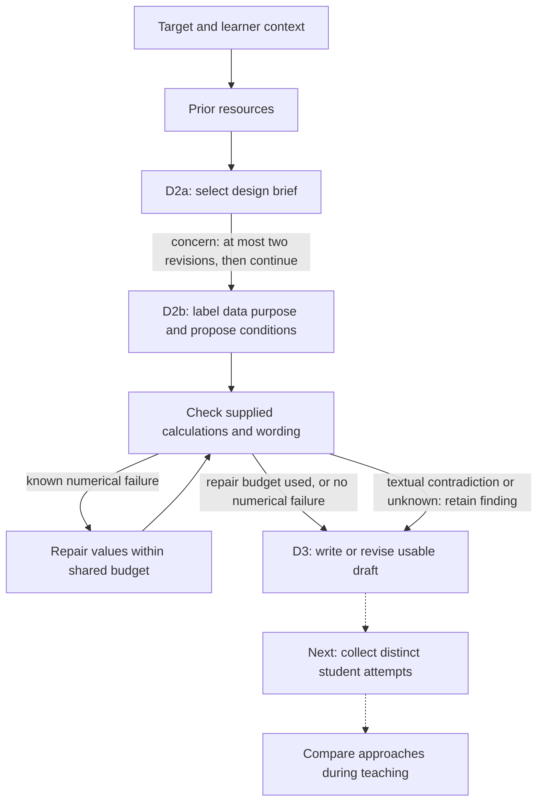

# Master Thesis: Current Research Status

**Updated October 15, 2026 from local code, saved artifacts, and project notes.**
This replaces the August status snapshot, not the historical experiments.

## Where the project stands

The initial five-measure rubric remains frozen as `pf-task-measures/v1`; the
subsequent three-role instrument `pf-three-role/v2.1` has completed computational
development, reserved-transfer checks and all-saved-task application. The
[results report](../../experiments/results/pf_measure_campaign_20261014/report_final/report.html)
covers 893 distinct task/target/history conditions across direct and pipeline
runs, with 5,256 full-application model calls and 660 replayed calculator checks.
Luna is the primary exploratory reviewer; GPT-4.1 is a more permissive comparison
series. References are assistant-provisional, not human ratings. Approach limits
remain especially dependent on which methods the solver elicits; no validated
PF-quality score, human agreement or learner outcome has been established.
See the [completed evidence and boundaries](../pf-generation/PF_PIPELINE.md#completed-results-and-verification-october-14--15).
The solver and evaluator development line continues through `pf-three-role/v2.5`–`v2.8`
(uncapped approaches, principle labels, two solvers, and in `v2.8` moving the accessibility
gate to the task judge, where Luna matched 20/20 development/control references and passed
all 8 strict sensitivity cases across two repeats); see the
[v2.5–v2.8 entries](../pf-generation/PF_PIPELINE.md).

The current generation pipeline is implemented, and D2b's agreed data-checking
and repair scope is complete. On October 15, 2026, a bounded two-round pipeline
improvement integrating the Learning Commons v1.14.0 progression graph (`buildsTowards`
prerequisites and `supports` learning components) with D2a/D2b familiar-shortcut
impasse checks and unadorned D3 student wording raised the `pf-three-role/v2.9`
all-five-measures pass rate on the 3-family × 3-repeat benchmark from `3/9` (`33%`)
in the earlier saved pipeline to `5/9` (`56%`, Round 1) and `7/9` (`78%`, Round 2,
with `9/9` alignment, `9/9` accessibility, `9/9` approach limits, `8/9` invention,
and `7/9` validity), compared with `12/31` (`39%`) across combined direct-generation
cohorts (`5/16` in Rahimi Main30 Direct, `1/6` in Benchmark v4 Direct, `6/9` in
Latest Direct). On October 16, 2026, a 20-topic 2-arm Progression Bridge ablation starting
from Stage D1 without hand-written teacher priors (`experiments/results/pf_progression_bridge_20cases_20261016/summary.json`)
showed that Learning Commons v1.14.0 progression grounding (`buildsTowards` + `supports`)
raised mean Progression Bridge Fit from `1.30/2.00` (`11/20` exact bridges, `5/20` boundary
misses) to `1.65/2.00` (`14/20` exact bridges, `1/20` boundary miss), eliminated Stage D1
target leakage (`3/20 -> 0/20`), reduced Stage D3 target leakage (`3/20 -> 1/20`), and
improved `v2.9` mathematical validity (`16/20 -> 18/20`) and room for invention (`8/20 -> 11/20`).
Expanding the dataset to 30 CCSSM topics across Grades 5–10 (stripped of `"rather than [shortcut]"` prompt hints) and evaluating all three arms (`Direct`, `Pipeline without LC`, `Pipeline with LC`, `90/90` tasks produced in `experiments/results/pf_progression_bridge_30cases_3arms_20261016/summary_three_arm.json`) with the Two-Gate Prior-Set & $K_{\text{valid}}$-Only Solver Trap protocol showed a clear two-step gain: Gate 1 invalid/spoiler prior sets dropped from `15/30` (`50.0%`) in Direct generation to `4/30` (`13.3%`) in Pipeline without LC and `0/30` (`0.0%`) in Pipeline with LC, while productive traps (Score 2) rose from `6/30` (`20.0%`, mean `0.70/2.00`) in Direct to `17/30` (`56.7%`, mean `1.43/2.00`) in Pipeline without LC and `21/30` (`70.0%`, mean `1.70/2.00`) in Pipeline with LC.
Earlier expert comparisons and model reviews raised
specific concerns about narrow student decisions and possible giveaways. The
October 13 same-task audit did not corroborate those as shared concerns among
high-rated tasks, but its judges were imperfect and 44/54 checklist outcomes
remained unknown. Human interpretation and student evidence remain absent.

The LLM-student simulation/feedback component is closed as a bounded computational
pilot. Operational path coverage is implemented and auditable; model-conditional
reachability and both feedback comparisons are recorded. No general added PF
improvement, realistic classroom distribution or learner outcome is established.
The thesis-ready [closure and boundaries](../pf-generation/PF_PIPELINE.md#final-findings-and-thesis-boundary-component-closed)
separate completed diagnostic research from future human studies.

The October 12--13
[measurement-gap and grounding campaign](../pf-generation/PF_PIPELINE.md#october-12--13-authorized-measurement-gap-and-grounding-research)
has two separate strands. The same-task audit is complete: among 41 sampled
tasks with original totals of at least 14/15, it found no concern meeting its
two-judge and exact-quote rule. Control misses, a lenient judge, and many
unknowns limit that null result. The three-arm grounding study is complete:
20 tasks each with no references, local curriculum, or local plus Learning
Commons, holding D1 priors fixed. Curriculum showed directional component
support gains, but 59/60 primary checklist outcomes remained unresolved.
Learning Commons showed no consistent additional gain. Neither establishes
an educational-quality advantage. The
[final comparison](../../experiments/results/pf_grounding_study_20261013/final_comparison/report.html)
preserves the repaired prior-history handoff, per-target differences and
uncertainty. A separate parent-run evaluator sensitivity added common subject
and jurisdiction context and yielded 2/60 supported checklist tasks; because
its input context differs, it is preserved but not pooled with the calibrated
primary comparison. Both campaigns stop here; the simulation campaign remains
closed.

Final software validation passes 260 focused tests, targeted Ruff and Python
compilation. Thesis method/experiments/results/discussion sources are updated.
`make thesis` could not produce a PDF because `latexmk` is absent; source-level
checks are not a substitute for a successful LaTeX build.

The new campaign's evaluator, history adapter, generation/catalog runner and
paired reporting passed 81 focused tests, targeted Ruff and compilation.
This checks software, not PF quality or the validity of its model judges.

The measurement-gap parser/aggregation v1.3 correction separately passed 70
targeted tests and made no model calls; it changes the analysis of the same
responses, not the prompt or the judgments.

The [PF pipeline record](../pf-generation/PF_PIPELINE.md) is the canonical
account of methods, improvement journeys, and limitations. A slide-style summary
of the motivation, process and results is in
[PF_RESEARCH_PRESENTATION.html](PF_RESEARCH_PRESENTATION.html); its charts are
generated from the saved summaries by
[render_pf_research_presentation.py](../../scripts/render_pf_research_presentation.py).

## Current implementation versus research evidence

| Component | Implemented / recorded | What is not established |
|---|---|---|
| MCQ generation | Historical condition experiments, current basic distractors, and optional structured faulty steps and reasoning paths | Distractor plausibility or matching does not establish PF quality; full pathway-to-PF evaluation is future work |
| MCQ evaluation | Deterministic answer incorrectness, compact model-estimated plausibility, optional coherent-path checks, and secondary Eedi matching | A plausibility screening flag is not human validation; unusable paths cannot support pathway-diversity claims |
| Prior-resource recommendation | Grounded curriculum/textbook retrieval and an ungrounded comparison, shared output schema, optional teacher skills | Resource coverage is limited; predicted first moves are not observed student methods |
| D2a design selection | Versioned v1/v2 briefs, internal discovery notes, two bounded revisions then usable-brief continuation with findings | V2 remains experimental: its earlier-policy comparison missed the gain/readiness rule; the later nine-attempt draft-first route completed but showed no general advantage over direct generation |
| D2b data/check/repair | Exact predicates, textual judgments, bounded values-only repair, data roles and continuation with unresolved findings | Roles are model-assigned; checker results remain separate from permission to produce a draft |
| D3 student-task writing | Keep/withhold, quoted omissions, internal examples and up to three writer calls before retaining usable text with findings | A produced draft is not a mathematical or educational pass; no student-outcome evidence |
| Optional Learning Commons evidence | Retrieval and handoff through generation, with a small paired development comparison | General task-quality improvement has not been demonstrated |
| Student simulation | Completed solution-blind probes, learning-record manipulation, Kapur reference, nine-design operational path audit and prospective final evaluation | Profiles/class mixtures remain hypothetical; reach differs by model. Fine automatic labels were unreliable; no real-student fidelity or learning validation |
| Refinement and consolidation | Completed raw-attempt rewrite and final design-level path-feedback comparisons; bounded optional feedback hook, codebooks and reports | Neither shows predefined added advantage over strong review; no global generator promotion or observed-student teaching/learning study |
| Thesis writing | Authored LaTeX draft with historical results and evolving methods | Proposed protocols must remain distinct from completed experiments |

## Current PF generation route

D2b allows at most three data model calls, including invalid proposal replies.
After a valid proposal, repairs cannot change conditions, formulas, quantity
meanings, units, roles, or data shapes. Textual claims that appear supported remain
model judgments. Failed and unsupported conditions remain findings rather than
stopping writing. A textual error is not repaired by changing numbers, but no
longer prevents repair of a separate numerical failure.

The [draft-first completion policy](../pf-generation/PF_PIPELINE.md#october-11-draft-first-completion-policy)
revises selection concerns at most twice and writer issues within three calls,
then returns the latest usable draft with unresolved findings. The fresh method
comparison produced nine of nine pipeline drafts under this policy, without
establishing a general PF-quality advantage. Genuine execution errors or no usable
output remain explicit; historical comparison results are unchanged.

New proposals label necessary observations and constraints as `given`, and chosen
feasibility constructions as `teacher_example`. Both are checked; only givens enter
D3's student-data section. An open construction can legitimately need no supplied
numbers. Historical unlabeled inputs remain readable without relabeling.

The historical skeleton -> mathematical plan -> meaning review -> fill route is
retained for explicit legacy protocols and saved results, not the current default.

## Latest measured evidence

**Final component closure.** Nine original pipeline designs were audited against
72 saved learner attempts, with 38 path/reference definitions and 304 explicit
matches. The final structural comparison produced six usable redesigned tasks
and 162 fresh requests over nine variants (158 complete; four cutoffs).
Prospective path definitions were frozen first. Task-only requirements are met
by 2/3 original, 2/3 specific design-review and 3/3 coverage-feedback tasks; the
gain +1 misses the predefined +2. The difference is sensitive to a tiny literal
precision defect, not a general educational advantage. Both speed rewrites
create a real rest/route choice but still elicit one aggregate-rate method.
The unchanged division trimming path is reached in 0/8 GPT-4.1 learner attempts
versus 4/4 GPT-5.4, demonstrating model-dependent diagnostics, not student rates.
See the [final report](../../experiments/results/pf_path_coverage_final_20261012/final_report.html).
Actual final campaign requests are 238/294 maximum. This closes automatic
research; no more tuning or human-learning claim follows.

**Kapur pathway-reference check: completed.**
A separately frozen source-normalized bicycle-handover task received 24 learner
attempts, four ordinary-solver attempts and two prediction-only requests after
four arithmetic controls. All requests returned parseable output. Reference
categories from the paper are withheld from model prompts and used only to code
actual work. Of 24 learner replies, 19 use algebra and six numerical trials
(one uses both); 21 finish correctly, two unfinished and one incorrect.
Seven show unsuccessful
intermediate work, but no learner enacts a ratio/LCM partition strategy or diagram.
Predictors anticipate those absent methods. The task is a simplified paraphrase,
and individual written attempts are not equivalent to the paper's group
discussions; neither coverage nor absence proves learner fidelity. See the
[protocol and limits](../pf-generation/PF_PIPELINE.md#october-11-source-normalized-kapur-pathway-reference-check)
and [reference results](../../experiments/results/pf_kapur_reference_20261011/reference.html).

**Attempt-informed revision comparison: completed negative result.** Six selected
tasks have unchanged, ordinary-revision and attempt-informed versions. Equal
revision model/instructions/call caps differ only by whether eight saved learner
attempts are supplied. Label-hidden assistant task review finds five original,
six ordinary and four informed tasks meeting the predefined design conjunction;
the informed arm misses the required +2 gain and has one unresolved general
fairness claim. All 216 fresh evaluation requests finish: 209 complete and seven
token cutoffs. Fresh speed methods do not differ and the historical timing misread
does not recur even on originals. Consistency method emphasis changes without
establishing better PF; division reveals task-demand and model-execution limits.
The [comparison](../../experiments/results/pf_attempt_revision_20261011/comparison.html)
and [canonical findings](../pf-generation/PF_PIPELINE.md#october-11-matched-attempt-informed-revision-pilot)
retain all outcomes. No global generator change or further tuning was promoted.

**Controlled learning-record check: completed.** A new
four-task study varies only the recent-learning record: usual prerequisites, one
omitted prerequisite, an additional learned method, and ordinary-solver control.
Two models and three repetitions produce 96 fresh requests, 94 complete replies
and two token cutoffs. Eight arithmetic controls are separate. Source-quoted
anonymous coding finds actual averaging in 8/12 usual-prerequisite versus 1/12
mean-omitted consistency replies, and actual variance/SD in 0/12 usual versus
12/12 added-method replies. In fair division, added methods are applied in 7/12
and merely mentioned in 4/12, with one truncated case unknown; two-person
Divider-Chooser is never executed. Method use is not correct execution or learner
fidelity. A 32-output second-reader spot check agrees on prerequisite application
in 32/32 and advanced application in 31/32; original ratings remain preserved.
Keyword screening is not the outcome.
See the [pre-run protocol and execution](../pf-generation/PF_PIPELINE.md#october-11-controlled-learning-record-study-frozen-before-requests).
No task or learner prompt was tuned and no learning/fidelity claim follows.
See the [observed resource-use chart and attempts](../../experiments/results/pf_learning_record_20261011/learning_record.html).

**Full-panel diagnosis and checklist calibration.** The 18 frozen direct/pipeline
tasks now have 216 fresh LLM attempts: 211 complete responses, five token cutoffs,
zero API failures. The separate second assistant reading agrees with original
mathematical status in 45/48 earlier attempts; automated exact method sets agree
in only 16/48, so the detailed diversity instrument is not validated. Eighteen
panel reviews retain 27 unverified evidence fields. Subsequent source checks
find one supported timing-clarification candidate, one optional clarification,
two rejected required-change claims and one design tradeoff. A reviewer wrongly
called valid stage durations a numerical contradiction; the generator was not
changed. See the
[baseline findings](../pf-generation/PF_PIPELINE.md#attempt-based-feedback-research-baseline-diagnosis-started-revision-not-started)
and [diagnosis gallery](../../experiments/results/pf_student_diagnosis_20261011/diagnosis.html).
This completes exploratory diagnosis, not proof of feedback-driven improvement.

**First open-ended LLM-student diagnostic.** Two consistency and two fair-division
tasks were attempted by GPT-4.1-mini and GPT-4.1 under ordinary-solver,
recent-prerequisite and one-prerequisite-gap conditions, twice each. All 48
requests finished: 42 complete replies, six token-truncated replies retained.
On consistency, named variance/standard-deviation use was 7/8 ordinary-solver
attempts and 0/16 learner-role attempts; learners used range, concentration and
absolute departures instead. However, arithmetic means were still calculated
in two of four gap-profile replies on one task. This is prompt-sensitive method
variation, not evidence of genuine missing knowledge or real-student fidelity.
All 24 fair-division replies applied claim/greedy/proportional reasoning; some
contained allocation/value errors. No productive-failure or learning claim follows.
See the [research and findings](../pf-generation/PF_PIPELINE.md#first-pf-learner-probe-findings)
and [attempt gallery](../../experiments/results/pf_student_probe_20261011/attempts.html).
Thirteen primary papers were reviewed; the erroneous Lu/Wang bibliography entry
was corrected. No second tuning round followed that probe; the later frozen
18-task diagnosis above is a separately identified baseline extension, not PF refinement.

**Completed frozen method comparison.** Strong direct generation and the current
pipeline each produced nine tasks on three expert directions. Assistant review
with method labels hidden found consequential choices in six tasks per method,
and common mathematical checks left one unresolved case per method. Direct used
nine requests; pipeline used 78. The clearest finding is task-family dependence:
fixed speed calculations, consistency-measure invention, and variable-quality
fair-division conflicts. See the
[canonical findings](../pf-generation/PF_PIPELINE.md#october-11-moving-from-prompt-tuning-to-method-comparison).
No student attempts or independent human ratings were collected.

**Completed bounded D2a experiment: partial gain, failed promotion rule.** The
[discovery-separation comparison](../pf-generation/PF_PIPELINE.md#october-11-bounded-d2a-discovery-separation-experiment)
ran eight frozen-D1 topics three times per version. Old versus changed produced
23 versus 18 ready tasks from 24 attempts each; disclosure-free ready tasks were
12 versus 14 (higher is better). The gain of two misses the required six, and
five fewer ready tasks exceeds the allowed loss of one. Separate assistant math
reading found two missing-data tasks only in the old arm, and one unresolved
wording case per arm; unknowns did not pass. Valid-and-accessible disclosure-free
tasks were 11 versus 14. All 48 attempts, including stops, have recorded ratings.

Development used 240 requests; four separate calibration attempts used twenty.
All 260 requests had usage records, with 451,749 output tokens including 275,234
reasoning tokens (not added twice); provider monetary prices are unverified.
The [report](../../experiments/results/pf_d2a_discovery_20261011/round1/comparison_report.json)
and [gallery](../../experiments/results/pf_d2a_discovery_20261011/round1/gallery/development/tasks.html)
preserve results. All 245 affected software tests and targeted Ruff passed.
**Stop this round, no demonstrated promotion:** v2 remains an implemented
experimental default, not a validated replacement. No further sweep was run.
This is assistant-read development evidence, not independent human ratings,
student attempts, learning evidence or state-of-the-art performance.

The [eight-case data-purpose rerun](../pf-generation/PF_PIPELINE.md#october-11-data-purpose-handoff-and-eight-fixed-brief-reruns)
produced eight tasks from eight fixed-brief attempts using sixteen model calls.
Direct assistant reading found student choices restored in all three fraction-card,
garden and box constructions, while all five observation/constraint controls retained
needed inputs. Two numeral-screen warnings were coincidental matches, not disclosed
sample orders. The [before/after gallery](../../experiments/results/pf_data_roles_20261011/frozen_8/tasks.html)
and [verification](../../experiments/results/pf_data_roles_20261011/frozen_8/verification.json)
preserve outputs, traces and arithmetic checks. All 160 affected software tests and
targeted Ruff passed; the full repository suite was not run.

This is selected development evidence with frozen D1 context and D2a briefs, not
a new end-to-end sweep or student experiment. Both data and writing changed.
The box task still imports example-specific integer/unit restrictions, the fraction
task over-withholds ordinary physical permissions, and the probability question
supplies a representation criterion. Role separation helps but does not establish
reliable disclosure-free writing, approach diversity or learning.

Expert tasks also give support but keep the central unknown for students. Against
that standard, three of the eight rerun tasks leave the key idea open, three state
the target claim as the student's job, and two name the key idea. Four of those
five disclosures were already in the frozen selected design, so writer-only fixes
cannot remove them. In two cases both D2a proposals gave the idea away; in two the
selector chose the giveaway over a more open proposal; one entered through the goal
passed to the writer. A D2a change that separates the key idea from the student's
job is proposed, not implemented. See the
[expert-standard reading](../pf-generation/PF_PIPELINE.md#october-11-data-purpose-handoff-and-eight-fixed-brief-reruns).

An [automated-research review and proposed strategy](../pf-generation/PF_PIPELINE.md#october-11-automated-research-review-and-proposed-experiment-strategy)
now separates bounded generator optimization from educational hypothesis tests.
Public repository controllers and evaluators were inspected; no framework was
installed and no new model experiment was run. The recommendation is to reuse
the current runners for a focused D2a comparison, then freeze a version for new
test topics and independent evaluation. All twenty existing sweep topics remain
development material; a state-of-the-art or learning-effect claim is not established.

The [fresh twenty-topic sweep](../pf-generation/PF_PIPELINE.md#october-11-fresh-twenty-topic-generation-and-direct-inspection)
attempted all twenty configured topics and produced nineteen student tasks, with
one preserved data-check stop. All twenty outcomes were directly inspected by the
assistant. The final run used 172 model calls; three separate setup attempts used
nineteen more. Prompts stayed frozen, no final failures were replaced, and final
call traces and source integrity were verified.

The [exact task gallery and per-topic notes](../../experiments/results/pf_topic_sweep_20261011/final_20/tasks.html)
show a mixed result. Inequalities, circle-area method invention and competing causal
explanations offer promising reasoning opportunities. Other tasks reveal shared
units, square constructions, group-size correction, or prepared successful examples.
The survey task has impossible subgroup membership counts; the systems task has
misleading mass semantics. Percentage-rate meaning and table-only price prediction
also need clarification. The growth stop comes from contradictory generated data
conditions, not an impossible teaching concept.

Generation used fresh D1 mapping/expansion of forty-eight frozen official
prerequisite excerpts, not live curriculum retrieval. Missing or unrelated local
retrieval motivated this configuration after the setup attempts. This is selected
development coverage, not a matched improvement test or measured learner knowledge.
No student approaches or learning outcomes were collected.

The latest saved full [structured MCQ evaluation](../mcq/MCQ_EVALUATION_OVERVIEW.md)
covers 11 conditions, 200 questions, and three runs: 6,600 question-runs and
19,800 distractors. About 62--63% of answers in each condition remain unknown to
the restricted incorrectness checker, so decisive-answer rates cannot be
generalized to the entire set. These are saved August artifacts, not a new
evaluation performed in this documentation refresh.

The [final claim-policy summary](../../experiments/results/d2b_claim_policy_replays_20261010/final_validation_summary.json)
separates software replays, development calibration, and final live runs:

- Eight saved proposals passed offline rechecks; eight controlled mock repairs
  restored deliberately altered values. These are software checks, not new model
  tasks. Repeated replay folders contain the same inputs.
- Three frozen existing designs produced three ready tasks using five data and
  three writer calls. The two extra data calls were invalid-proposal retries;
  there were no numerical repairs in this final live phase.
- The final three textual judgments were all `holds`. Four of five quotations
  matched literally. This does not establish reliable discrimination of unknown
  and false claims or logical sufficiency of quotations.
- The affected software suite passed 551 tests, with targeted Ruff and compilation
  passing. The full repository suite was not run in that validation.

The earlier [fresh direct comparison](../../experiments/results/pf_fresh_design_comparison_20261010/summary.json)
delivered six direct and five pipeline tasks from six attempts per route. Its
one unsupported-claim stop used the earlier policy. It is a development-topic
comparison, not a held-out, budget-matched, or causal quality experiment.
No student responses or learning outcomes were collected in either comparison.

## What the expert comparison exposed

| Task direction | Current limitation | Needed next evidence or design work |
|---|---|---|
| Average speed | Compares fixed journeys, unlike the expert's unknown bicycle-handover point | A consequential construction or choice, not simply another display of a rate |
| Consistency | Supports measure invention but announces equal averages and extremes | Preserve discovery of familiar-summary limits; valid non-variance measures are not failures |
| Fair division | Supplies fair-share and successful-allocation received values; lists trimming-procedure actions | Separate student givens from teacher-only verification; keep needed valuation rules explicit; give concrete valuations where students can encounter competing claims |
| Across tasks | Listed approaches are predictions, not observed reasoning | Collect distinct attempts; calibrate challenge without forcing every method to fail |

See the [quality interpretation](../pf-generation/PF_PIPELINE.md#october-10-quality-interpretation-and-agreed-next-focus)
and [Kapur source evidence](../pf-generation/KAPUR_BIELACZYC_2012_EVIDENCE.md).
The Loibl task record is a reconstruction without its complete original numerical
table, not an exact student-text gold standard.

## Historical findings retained, with appropriate limits

- The earlier 21-task AI review rated the three direct-generation conditions at
  9.00, 8.14, and 9.29 out of 15, with multiple representations/solutions at
  1.00 out of 3 in each condition. These are historical AI ratings, not a
  human-validated ranking or the current pipeline's scores.
- Historical MCQ matching reached about 22% in the tested conditions. That does
  not establish a universal prompting ceiling or make Eedi answer matching the
  primary measure of plausible error pathways. See the
  [MCQ evaluation record](../mcq/MCQ_EVALUATION_OVERVIEW.md).
- The [simulation notebook](../../notebooks/08_simulated_student_pipeline.ipynb)
  reports matching answer rankings and improving distribution fit on a small
  development sample. A rank correlation of 1 does not mean identical answer
  distributions. Its proposed held-out evaluation must not be described as
  completed independent validation.
- The paper-setting v4 generation benchmark and later rubric reratings are
  separately versioned historical experiments. They do not measure the current
  default route or observed student learning.

## Agreed next focus

The LLM-student/path-coverage/feedback component is now closed as the
[bounded computational study](../pf-generation/PF_PIPELINE.md#final-findings-and-thesis-boundary-component-closed).
No further automatic tuning is planned. The next thesis work is independent
educational/human validation if its scope and ethics permit it, not replacing
negative results or manufacturing missed paths. The historical development
decisions below remain for provenance.

The user requested moving beyond prompt tuning. The frozen direct/pipeline
comparison is now complete: nine drafts per method on three existing expert
directions, with two calibration cases kept separate. Both methods offer
consequential choices in six of nine tasks; both have one unresolved mathematical
case. The predefined conjunction of supported mathematics, preserved target,
accessible start, no disclosure and a consequential choice counts five per method.
Direct used nine model requests; pipeline used 78. No general pipeline advantage
is established by this small assistant-reviewed, unequal-compute comparison.
Speed remains fixed calculation, consistency supports measure invention, and
fair division varies in whether a solvable standoff actually occurs. See the
[tasks and findings](../../experiments/results/pf_method_comparison_draft_first_20261011/fresh/side_by_side.html).
The [protocol](../../experiments/configs/pf_method_comparison_draft_first_20261011.json)
and [canonical decision](../pf-generation/PF_PIPELINE.md#october-11-moving-from-prompt-tuning-to-method-comparison)
preserve the inspected-topic, unequal-compute and assistant-review limitations.
The baseline diagnosis and subsequent six-case revision study are now complete.
The [revision comparison](../pf-generation/PF_PIPELINE.md#october-11-matched-attempt-informed-revision-pilot)
does not establish an added benefit from raw simulated-attempt feedback over
strong task-review-only revision. Stop this bounded intervention rather than
promote it or tune its evaluator. A filtered task-evidence feedback package is
future work, requiring a separately frozen comparison. Before claims about
students, a
[simulator validation plan](../pf-generation/PF_PIPELINE.md#proposed-simulator-validation-is-the-llm-student-fit-for-pf-diagnosis-not-started)
proposes placebo and grade-only controls and matched task-sensitivity pairs,
which remain unrun. The source-normalized Kapur reference is now complete but
does not reproduce real group pathway distributions. No real student attempts, learning outcomes
or general simulator-driven PF improvement has been established, and no additional
automatic tuning round is authorized.
The earlier discovery-separation experiment remains a negative result, not a
promoted replacement. Its unresolved mechanisms remain recorded findings rather
than prerequisites for starting the broader educational comparison.
Collect student attempts before claiming approach diversity, productive failure,
or benefit from subsequent teaching. Keep human ratings, model judgments,
software checks, and learning evidence separate throughout the thesis.

## October 10 documentation refresh

Active README guidance, research notes, HTML companions, thesis chapters and
citations were aligned with current code and saved evidence. Historical curated
resource propagation was separated from current holdout claims; overstated
simulation validation and universal prompting limits were removed.

Validation checked 28 authored Markdown/HTML documents, 453 local links including
12 anchors, 28 bibliography keys and 78 citation uses. Static JavaScript/TeX
checks, offline CLI inspections, and dashboard interaction checks passed. The
Learning Commons context figure was regenerated from its updated SVG. Thesis
PDF compilation remains blocked because `latexmk` is unavailable. No new model
experiments or software-test-suite run were performed for this refresh.
